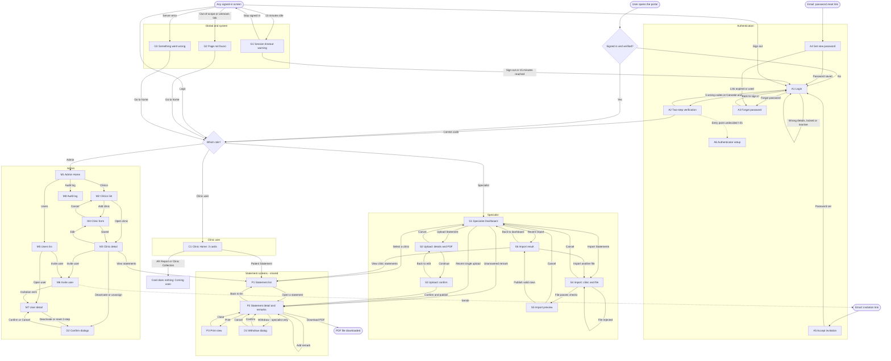

# App Flow: My Patient

| | |
|---|---|
| **Product** | My Patient (patient statement portal) |
| **Company** | US24 Solutions |
| **Version** | v1 |
| **Document status** | Draft for review |
| **Date** | October 21, 2026 |
| **Inputs** | 01-prd.md (approved), 02-trd.md (approved) |

### How to read this document
- **Screen IDs** group screens by area: **A** for authentication, **C** for clinic user, **S** for specialist, **M** for admin, **P** for statement screens shared by several roles, **D** for dialogs and **G** for global or system screens.
- **Routes** are proposed page addresses. Neither the PRD nor the TRD fixes them, so developers may rename them.
- **[I-xx]** marks a flagged issue: a flow that the PRD and TRD leave missing, unclear or contradictory. All flagged issues are listed in Section 5. Where a flow is flagged, this document describes a *proposed* behaviour, labelled **Proposed**, and it needs approval before build.
- Dates and times are shown in the user's browser time zone, with the zone label (TRD Q8 default).

---

## 1. Journey Summary

### 1.1 Primary journey: a statement goes from US24 to the clinic
1. A **specialist** signs in with email and password, enters a 6-digit code, and lands on the **Specialist Dashboard**.
2. They choose **Import Statements**, pick one of their assigned clinics and upload a spreadsheet. The portal checks every row and shows a **preview** with valid rows, invalid rows and possible duplicates.
3. The specialist checks that the clinic name is right and selects **Publish valid rows**. A **result summary** shows what was published and offers a downloadable error report.
4. A **clinic user** at that clinic signs in, also with a 6-digit code, and lands on the **Clinic Home** with three cards. Only **Patient Statement** works.
5. They open **Patient Statement**, see the new statements marked **New**, search for a patient, and open the **Statement Detail**.
6. They read the statement and its remark history, add a **Clinic remark**, and can **download** or **print** the statement.
7. The specialist sees the clinic's remark in **Unanswered remarks** on their dashboard, opens it, and replies with a Specialist or Insurance remark.

### 1.2 Secondary journeys
- **Single upload:** a specialist uploads one PDF for one patient, confirms the clinic and patient, and publishes.
- **Withdrawal:** a specialist withdraws a statement published by mistake, giving a reason. The clinic stops seeing it.
- **Clinic onboarding:** an admin creates a clinic, invites its users, and assigns a specialist. Each invited user sets a password from the invitation email, then signs in with 2-step verification.
- **Staff changes:** an admin deactivates a user, which signs them out immediately. An admin can also resend an invitation or reset someone's 2-step setup.
- **Compliance check:** an admin filters the audit log and exports it.
- **Forgotten password:** a user requests a reset link, sets a new password, and signs in again with 2-step verification.
- **Session timeout:** after 13 idle minutes a warning appears. The user either stays signed in or is signed out at 15 minutes.
- **Blocked access:** a user who follows or edits a link to something outside their access sees **Page not found**, and the attempt is logged.

### 1.3 Where each role lands after signing in

| Role | Lands on |
|---|---|
| Clinic User | C1 Clinic Home |
| Specialist | S1 Specialist Dashboard |
| Admin | M1 Admin Home |

---

## 2. Screen Inventory

| ID | Screen | Proposed route | Roles | PRD source |
|---|---|---|---|---|
| A1 | Login | `/login` | Public | F1, FR-1.1, 1.5, 1.10 |
| A2 | Two-step verification | `/login/verify` | Password step passed | F2, FR-1.2–1.4 |
| A3 | Forgot password | `/password/forgot` | Public | F3, FR-1.7 |
| A4 | Set new password (reset) | `/password/reset/<token>` | Link holder | F3, FR-1.6, 1.7 |
| A5 | Accept invitation (set password) | `/invite/<token>` | Link holder | FR-1.8 |
| A6 | Authenticator app setup | `/account/authenticator` | Any signed-in user | FR-1.2 (**entry point undefined, I-01**) |
| C1 | Clinic Home (three cards) | `/home` | Clinic User | N1, FR-3.2–3.4 |
| S1 | Specialist Dashboard | `/dashboard` | Specialist | F6, FR-5.1–5.3 |
| S2 | Upload statement: details and PDF | `/statements/upload` | Specialist | F7, FR-6.1, 6.2 |
| S3 | Upload statement: confirm | `/statements/upload/confirm` | Specialist | FR-6.3, 6.4 |
| S4 | Import statements: choose clinic and file | `/imports/new` | Specialist | F8, FR-7.1–7.3 |
| S5 | Import preview | `/imports/<batch>/preview` | Specialist | FR-7.4, 7.5 |
| S6 | Import result summary | `/imports/<batch>` | Specialist | FR-7.6 |
| P1 | Statement list | Clinic: `/statements`; staff: `/clinics/<clinic>/statements` | Clinic User, Specialist, Admin | F9, FR-9.1–9.5 |
| P2 | Statement detail (with remarks log) | `/statements/<id>` | Clinic User, Specialist, Admin | F10, F11, F12 |
| P3 | Print view | `/statements/<id>/print` | Clinic User, Specialist, Admin | FR-12.2, 12.3 |
| D1 | Withdraw statement dialog | On P2 | Specialist | FR-10.4 |
| M1 | Admin Home | `/admin-home` | Admin | FR-3.5 (**content undefined, I-06**) |
| M2 | Clinics list | `/manage/clinics` | Admin | FR-4.1 |
| M3 | Clinic detail | `/manage/clinics/<id>` | Admin | FR-4.1–4.3, 4.6 |
| M4 | Clinic form (add / edit) | `/manage/clinics/new`, `/manage/clinics/<id>/edit` | Admin | FR-4.1 |
| M5 | Users list | `/manage/users` | Admin | FR-4.2, 4.4 |
| M6 | Invite user | `/manage/users/invite` | Admin | FR-4.2, FR-1.8 |
| M7 | User detail | `/manage/users/<id>` | Admin | FR-4.3–4.5 |
| M8 | Audit log | `/manage/audit` | Admin | F13, FR-13.3 |
| D2 | Confirm dialogs (deactivate user, deactivate clinic, reset 2-step, unassign specialist) | On M3 / M7 | Admin | FR-4.3–4.6 |
| G1 | Session timeout warning | Overlay on any signed-in screen | All signed-in | FR-1.9 |
| G2 | Page not found | Any unknown or out-of-scope address | All | FR-2.5 |
| G3 | Something went wrong | Any address, on server error | All | TRD reliability |

Two things are **not screens**: the shared header (Section 4.1) and file downloads (statement PDF, import template, error report, audit export).

---

## 3. Mermaid Flowchart

---

## 4. Screen-by-Screen Behaviour

### 4.1 Global behaviour (applies to every signed-in screen)

**Header (N2, N3, FR-3.1)**
- **Left:** the signed-in user's full name.
- **Right:** the US24 Solutions logo, plus a **Sign out** button next to it.
- The header has no other menu, because the brief asks for a minimal layout.

**Navigation (Proposed, I-05)**
- Selecting the logo returns the user to their role's landing screen (C1, S1 or M1).
- Every screen below a landing screen shows a **Back** link to its parent. Examples: "Back to statements" on P2, and "Back to dashboard" on S2–S6.

| Action | Outcome | Destination |
|---|---|---|
| Sign out | Session ended; audit event "logout" | A1, with the message "You have signed out." |
| Logo | — | C1, S1 or M1 (by role) |

**Access rules (FR-2.5, I-04)**
- A user who opens a statement, clinic, import or user record outside their access sees **G2 Page not found**, and a "blocked access" audit event is recorded.
- **Proposed:** the same applies when a user opens a page meant for another role, for example a clinic user opening `/dashboard`.

**Session (FR-1.9, FR-4.4)**
- After 13 idle minutes, **G1** appears.
- At 15 idle minutes the session ends. The user is sent to A1 with the message "You were signed out after 15 minutes of inactivity."
- If an admin deactivates the user, their next action sends them to A1 with the generic message "Your session has ended. Please sign in again."

**Loading, saving and errors on in-page updates** (filters, paging, adding a remark)
- **Loading:** the affected area shows a busy indicator, and its button is disabled to prevent double submission.
- **Connection lost or request failed:** an inline message reads "Couldn't save. Check your connection and try again." Typed text is kept.
- **Session expired during an update:** the user is sent to A1. Unsaved text is lost; I-27 proposes a warning.

**Caching (TRD 5.3)**
- Pages with patient data are never cached. Pressing the browser's Back button after signing out shows A1, not patient data.

---

### A1 – Login
**Purpose:** Start a sign-in with email and password.

**Reached from:** opening the portal while signed out; signing out; session timeout; a link in an invitation or reset flow; "Back to sign in" on A3; a failed 2-step attempt.

**Information shown**
- US24 Solutions logo in the top-right corner (FR-1.1).
- Email field, password field, a **Sign in** button and a **Forgot password?** link.
- A message area for sign-out, timeout, password changed, password set and error messages.

**Actions**

| Action | Outcome | Next |
|---|---|---|
| Sign in with a correct email and password, on an active account at an active clinic | A password-step success is logged and an email code is sent (or the authenticator option is offered, see I-25) | A2 |
| Sign in with a wrong email or password | The generic message "Email or password is incorrect." Failed login is logged (FR-1.10) | A1 |
| 5th failed attempt within the lock window | Account locked for 15 minutes; logged (FR-1.5). Message wording: see I-03 | A1 |
| Sign in as a deactivated user, a user at a deactivated clinic, or a user who hasn't accepted their invitation | The same generic message as a wrong password (FR-1.10) | A1 |
| Forgot password? | — | A3 |

**States and edge cases**
- **Loading:** the Sign in button is disabled and shows "Signing in…".
- **Empty fields:** inline "Enter your email" or "Enter your password" messages.
- **Already signed in and verified:** the user is redirected to their landing screen.
- **Signed in but not yet verified** (left during the 2-step step): the user is redirected to A2, or to A1 if the verification attempt has expired.
- **Email service down:** see A2.

---

### A2 – Two-step verification
**Purpose:** Confirm identity with a second factor on every login (FR-1.4).

**Reached from:** A1, after a correct password. No other screen can be reached until this step is complete.

**Information shown**
- "We sent a 6-digit code to j\*\*\*@clinic.com. It expires in 10 minutes." The email address is partly masked.
- A 6-digit code field (numeric keypad on phones) and a **Verify** button.
- A **Resend code** link (**Proposed**, I-02).
- A **Cancel and return to sign in** link.
- If the user has an authenticator app: "Use your authenticator app instead" (or the reverse, see I-25).

**Actions**

| Action | Outcome | Next |
|---|---|---|
| Verify with the correct code | Session becomes verified; 2-step success logged | Role landing screen (C1, S1 or M1) |
| Verify with a wrong code | "That code is incorrect. You have N tries left." Logged | A2 |
| Verify with an expired or already-used code | "That code has expired. Request a new code." | A2 |
| 5th wrong code | "Too many incorrect codes. Please sign in again." Logged (FR-1.3) | A1 |
| Resend code (Proposed) | A new code is sent and the old one is cancelled. Limited, for example to once a minute | A2 |
| Switch to the authenticator app | The field label changes to "Code from your authenticator app" | A2 |
| Cancel | Partial sign-in is discarded | A1 |

**States and edge cases**
- **Loading:** the Verify button is disabled while checking.
- **Code email not arriving:** "Didn't get it? Check your spam folder or resend the code." Users with an authenticator app can switch to it (TRD flag on FR-1.2).
- **Code email cannot be sent** (service failure): "We couldn't send your code. Try again in a few minutes." The user stays on A2.
- **Deactivated during this step:** Verify fails with the generic message and the user returns to A1.
- **Phone layout:** the code field is large and the keypad is numeric.

---

### A3 – Forgot password
**Purpose:** Request a password reset link (FR-1.7).

**Reached from:** "Forgot password?" on A1; an expired or used link on A4.

**Information shown:** an email field, a **Send reset link** button and a **Back to sign in** link.

**Actions**

| Action | Outcome | Next |
|---|---|---|
| Send reset link (any email) | The same confirmation is always shown: "If an account exists for that email, we've sent a reset link. It expires in 30 minutes." An email is sent only if the account exists and is active (FR-1.10) | A3, confirmation state |
| Back to sign in | — | A1 |

**States and edge cases:** an empty or invalid email shows an inline error. A user arriving from an expired link sees "That link has expired or was already used. Request a new one."

---

### A4 – Set new password (reset)
**Purpose:** Set a new password from a valid reset link.

**Reached from:** the reset email link only.

**Information shown:** a new password field and a confirm password field, the rules ("At least 12 characters. Common or breached passwords aren't allowed.") and a **Save password** button.

**Actions**

| Action | Outcome | Next |
|---|---|---|
| Save with a valid password | Password updated and the link cancelled. All of the user's other sessions are ended (Proposed). Logged | A1, with "Password changed. Sign in with your new password." (2-step still required, FR-1.7) |
| Save with an invalid password | An inline reason: too short, too common, found in a known breach, or the two fields don't match | A4 |
| Open an expired or used link | — | A3, with the expired message |

**States and edge cases:** if the breached-password service is down, the basic checks are used and the save is allowed (TRD Q7, fail open).

---

### A5 – Accept invitation (set password)
**Purpose:** A new user sets their first password (FR-1.8).

**Reached from:** the invitation email link only (sent from M6 or by "Resend invitation" on M7).

**Information shown:** "Welcome, [Full name]. Set a password to activate your account." A new password field, a confirm field, the password rules and a **Set password** button.

**Actions**

| Action | Outcome | Next |
|---|---|---|
| Set a valid password | Account active and link cancelled; logged | A1, with "Your password is set. Sign in to continue." (Proposed, I-26) |
| Invalid password | An inline reason, as on A4 | A5 |
| Open an expired link (over 72 hours) or a used link | "This invitation has expired or was already used. Ask your US24 Solutions administrator to send a new one." | Stays on this message. The only action is "Go to sign in", which leads to A1 |

**States and edge cases:**
- If the user was deactivated before accepting, the link shows the expired message.
- If the user is already signed in as someone else, they are signed out before the invitation is shown (Proposed).

---

### A6 – Authenticator app setup
**Purpose:** Let a user add an authenticator app as their second factor (FR-1.2).

**Reached from:** **Not defined in the PRD (I-01).** The header only allows the user's name, logo and Sign out, and there is no account page.

**Information shown:** a QR code, a manual setup key, a field for the first 6-digit code from the app, and **Confirm** and **Cancel** buttons.

**Actions**

| Action | Outcome | Next |
|---|---|---|
| Confirm with a correct app code | Authenticator enrolled; logged. The app becomes available on A2 | Back to where the user came from (depends on I-01) |
| Confirm with a wrong code | "That code doesn't match. Check your phone's time and try again." | A6 |
| Cancel | Nothing is saved | Back to where the user came from |

**Edge cases:** if an admin resets 2-step (M7), the enrolled app is removed and the user falls back to email codes.

---

### C1 – Clinic Home
**Purpose:** A simple starting point for clinic users (N1).

**Reached from:** a successful A2 (clinic user); the logo; "Go to home" on G2 or G3.

**Information shown:** the header, and three centered cards with nothing else on the page (FR-3.2):
- **AR Report:** disabled, labelled "Coming soon".
- **Clinic Collection:** disabled, labelled "Coming soon".
- **Patient Statement:** active. **Proposed:** a count of new statements, for example "3 new" (N4).

**Actions**

| Action | Outcome | Next |
|---|---|---|
| Patient Statement | — | P1 for the user's clinic |
| AR Report or Clinic Collection | Nothing happens. The card is announced as "Coming soon, unavailable" to screen readers (FR-3.4) | C1 |

**States and edge cases:**
- **Phone layout:** the cards stack vertically, with Patient Statement first (Proposed).
- If PRD Q8 decides to hide the unfinished cards, only one card shows. This decision is still open in the PRD.

---

### S1 – Specialist Dashboard
**Purpose:** Show the specialist what needs attention and give them the publishing tools (F6).

**Reached from:** a successful A2 (specialist); the logo; "Back to dashboard" links; Cancel on S2, S4 or S5.

**Information shown (FR-5.1)**
1. **My clinics:** each assigned clinic with its statement count.
2. **Recent uploads and imports:** date, clinic, type (single or import), status (Published / Failed / Partially imported) and row counts.
3. **Unanswered clinic remarks:** newest first, showing clinic, patient name, account number, an excerpt of the remark, the author and the time.
4. **Upload Statement** and **Import Statements** buttons.

**Actions**

| Action | Outcome | Next |
|---|---|---|
| Select a clinic | — | P1 for that clinic (FR-5.2) |
| Select an unanswered remark | — | P2 for that statement, scrolled to the remark (FR-5.3) |
| Select a recent import | — | S6 for that batch (Proposed, I-22) |
| Select a recent single upload | — | P2 for that statement (Proposed, I-22) |
| Upload Statement | — | S2 |
| Import Statements | — | S4 |

**States**
- **No assigned clinics:** "You haven't been assigned to any clinics yet. Contact your administrator." The upload and import buttons are disabled.
- **No recent activity:** "No uploads yet."
- **No unanswered remarks:** "You're all caught up."
- **Loading** and **error:** see Section 4.1.

**Edge cases:**
- If a clinic is unassigned while the dashboard is open, it disappears on the next load, and its links lead to G2.
- How deactivated clinics appear is undefined (I-18).

---

### S2 – Upload statement: details and PDF
**Purpose:** Enter one patient's statement and attach its PDF (FR-6.1, 6.2).

**Reached from:** "Upload Statement" on S1; "Back to edit" on S3.

**Information shown**
- **Clinic** picker, listing only assigned, active clinics.
- **Required fields:** patient name, account number, statement date, balance due.
- **Optional fields (FR-8.2):** date of birth, dates of service, CPT codes, billed amount, insurance paid, adjustments, insurance name. The final field list depends on PRD Q1.
- A **PDF file** picker (PDF only, up to 10 MB).
- **Continue** and **Cancel** buttons.

**Actions**

| Action | Outcome | Next |
|---|---|---|
| Continue with valid data and a valid PDF | The file is checked to be a real, unencrypted PDF of 10 MB or less. Nothing is published yet | S3 |
| Continue with missing or invalid fields | Inline errors on each field. The entered values are kept | S2 |
| Continue with the wrong file type, a file over 10 MB, or an encrypted or damaged PDF | "Upload a PDF file up to 10 MB." or "This PDF can't be read or is password-protected." | S2 |
| Cancel | Nothing is saved | S1 |

**States and edge cases:**
- **Loading:** the upload shows progress, and Continue is disabled while uploading.
- If the session ends, the entered data and file are lost (I-27).
- Whether a single upload checks for duplicates is undefined (I-11).

---

### S3 – Upload statement: confirm
**Purpose:** Prevent publishing to the wrong clinic (FR-6.3, US-13).

**Reached from:** "Continue" on S2.

**Information shown**
- The prominent heading "Publish to: **[Clinic name]**".
- Patient name, account number, statement date, balance due and the PDF file name.
- The notice "Once published, [Clinic name]'s users can see this statement immediately."
- **Confirm and publish** and **Back to edit** buttons.

**Actions**

| Action | Outcome | Next |
|---|---|---|
| Confirm and publish | The statement is created, active and marked New. An upload is logged | P2 for the new statement, with the banner "Statement published to [Clinic]" (Proposed, I-13) |
| Back to edit | Values are kept | S2 |

**States and edge cases:**
- **Double-click:** only one statement is created, because the button is disabled after the first click.
- **Assignment removed between S2 and S3:** "You no longer have access to this clinic." Nothing is published; the user returns to S1.
- **Publish fails:** an error banner appears, nothing is published, and the user stays on S3.

---

### S4 – Import statements: choose clinic and file
**Purpose:** Start a bulk import for one clinic (FR-7.1, 7.2).

**Reached from:** "Import Statements" on S1; "Import another file" on S6.

**Information shown**
- A **Clinic** picker (assigned, active clinics only).
- A file picker for .xlsx or .csv files.
- A **Download template** link.
- The limits: "Up to 5,000 rows and 10 MB. One clinic per file."
- **Check file** and **Cancel** buttons.

**Actions**

| Action | Outcome | Next |
|---|---|---|
| Download template | The template file downloads | S4 |
| Check file, when the file passes file-level checks | Every row is validated (FR-7.3) and an import batch is created | S5 |
| Check file with the wrong file type, an empty file, over 5,000 rows or over 10 MB | A specific error message. The batch is recorded as **Failed** | S4 |
| Check file with missing required columns | "Missing columns: [names]." (Acceptance F8). Recorded as **Failed** | S4 |
| Cancel | — | S1 |

**States and edge cases:**
- **Loading:** "Checking your file… this can take up to 2 minutes." The page stays usable but the button is disabled (NFR-14).
- If the clinic picker is empty, the same message as S1 is shown.
- A network timeout shows "The check didn't finish. Try again." Nothing is published.

---

### S5 – Import preview
**Purpose:** Let the specialist review the results and confirm the clinic before anything is published (FR-7.4, 7.5).

**Reached from:** a successful check on S4.

**Information shown**
- The prominent heading "Importing to: **[Clinic name]**" and the file name.
- Totals: all rows, valid rows, invalid rows, possible duplicates.
- **Invalid rows:** row number, field, and a reason (for example, "Row 18: Statement date is not a valid date").
- **Possible duplicates:** rows whose account number and statement date match an existing statement. Each has a **Skip** / **Publish as new version** choice. **Proposed:** "Apply to all duplicates" controls.
- **Publish valid rows** and **Cancel** buttons.

**Actions**

| Action | Outcome | Next |
|---|---|---|
| Choose Skip or Publish as new version for each duplicate | The choice is saved on the preview | S5 |
| Publish valid rows | Valid rows (and duplicates set to Publish as new version) become active statements marked New. The batch status becomes Published or Partially imported, and an import is logged | S6 |
| Cancel | Nothing is published. The batch status is undefined (I-12) | S1 |

**States and edge cases:**
- **No valid rows:** "No rows can be published. Fix the file and try again." Publish is disabled, and **Download error report** and **Back** (to S4) are shown.
- **Duplicates with no decision:** Publish is disabled until every duplicate has a choice (Proposed).
- **Leaving the page without publishing:** nothing is published (I-12).
- **Clinic assignment removed before publishing:** publishing fails with "You no longer have access to this clinic."
- **Double-click on Publish:** only one publish happens.
- How "new version" statements appear to clinics is undefined (I-10).

---

### S6 – Import result summary
**Purpose:** Show what happened and give access to the error report (FR-7.6).

**Reached from:** a publish on S5; a recent import on S1.

**Information shown:** clinic, file name, date and time, the specialist's name, status, and counts for published rows, rows published as new versions, skipped duplicates and failed rows.

**Actions**

| Action | Outcome | Next |
|---|---|---|
| Download error report | A spreadsheet of failed rows with reasons downloads (safe against spreadsheet formulas, TRD 5.4) | S6 |
| View clinic statements | — | P1 for that clinic |
| Import another file | — | S4 |
| Back to dashboard | — | S1 |

**States:** when there are no failed rows, the error report link is hidden and "All rows published" is shown. Failed batches (from S4) show the error reason and no counts.

---

### P1 – Statement list
**Purpose:** Find statements for one clinic (F9).

**Reached from:**
- **Clinic user:** "Patient Statement" on C1; "Back to statements" on P2.
- **Specialist:** a clinic on S1; "View clinic statements" on S6; Back on P2.
- **Admin:** "View statements" on M3 (Proposed, I-07).

**Information shown**
- **Heading:** "Patient Statements." Specialists and admins also see the clinic name.
- Search box (patient name or account number, partial matches allowed), a statement date range ("from" and "to"), and sort by statement date (newest first by default), patient name or balance.
- **Table:** patient name, account number, statement date, balance due, last remark date and a **New** badge (FR-9.2). On phones each row becomes a card.
- Pagination, 25 per page (FR-9.5).
- **Clinic users** see active statements only (FR-9.1). **Specialists and admins:** whether withdrawn statements appear is undefined (I-08).

**Actions**

| Action | Outcome | Next |
|---|---|---|
| Type a search, change dates or change the sort | The list updates in place, and the filters are kept in the page address | P1 |
| Clear filters | The full list is shown | P1 |
| Open a statement (row or card) | — | P2 |
| Next or previous page | — | P1 |
| Back (staff only) | — | S1 or M3 |

**States**
- **Loading:** the table shows a busy indicator.
- **No statements yet:** clinic users see "No statements have been shared with your clinic yet." Staff see "No statements for this clinic yet."
- **No search results:** "No statements match your search," with **Clear filters**.
- **Invalid date range:** "The 'from' date must be before the 'to' date."
- **Error:** see Section 4.1.

**Edge cases:**
- A specialist opening the list for a clinic they aren't assigned to sees G2.
- A page number past the end shows the last page.

---

### P2 – Statement detail (with remarks log)
**Purpose:** View one statement, its full remark history, and act on it (F10, F11, F12).

**Reached from:** P1; S3, after publishing; an unanswered remark or a recent upload on S1; another statement link on P2; Close on P3; D1.

**Information shown**
1. **Back to statements** link.
2. **Summary:** patient name, account number, statement date, balance due, the clinic (staff only), and "Published [date] by [specialist]" (the display name depends on PRD Q2).
3. **Statement content:** for a PDF upload, the PDF shown in the page (see I-14). For an imported statement, the standard statement layout (FR-7.8; its design is PRD Q5).
4. **All other fields** (FR-8.2) that have values.
5. **Other statements for this patient** in the same clinic, as links (FR-10.3).
6. **Remarks log**, oldest first (FR-11.1). Each entry shows the author's name, role, date and time, the type (Clinic / Specialist / Insurance) and the text. Insurance entries also show the insurance company and reference number.
7. **Add a remark form**, which differs by role:
   - **Clinic user:** a text box (2,000 characters, with a counter). The type is always Clinic.
   - **Specialist:** a type choice (Specialist or Insurance). Insurance adds a required insurance company field and an optional reference number field.
   - **Admin:** whether admins can add remarks is undefined (I-07).
   - The hint "Remarks can't be edited or deleted after posting" is shown.
8. **Download PDF** and **Print** buttons.
9. **Withdraw statement** button, for specialists only.

**Actions**

| Action | Who | Outcome | Next |
|---|---|---|---|
| Open the page | All | A view is logged. If a clinic user opens it for the first time, the New badge is cleared (FR-10.2) | P2 |
| Post a remark (valid) | Clinic user, Specialist | The remark is added to the end of the log and logged. A specialist's remark clears "unanswered" for this statement (FR-11.7) | P2 (the log updates in place, the form clears and a "Remark added" message appears) |
| Post a remark: empty, over 2,000 characters, or Insurance without a company | Clinic user, Specialist | An inline error; the text is kept | P2 |
| Download PDF | All | A download is logged and the PDF is saved (the original upload, or the standard layout for imported statements) | Stays on P2 |
| Print | All | Choose "Include remarks" (yes or no) | P3 |
| Other statement for this patient | All | — | P2 for that statement |
| Withdraw statement | Specialist | — | D1 |
| Back to statements | All | — | P1 |

**States and edge cases**
- **Loading:** the page skeleton shows while loading. If the PDF fails to display, the message "Can't display the PDF here. Use Download PDF." is shown.
- **No remarks:** "No remarks yet."
- **Withdrawn statement:**
  - Clinic users who open it from an old link see **G2**.
  - Specialists and admins see a banner: "Withdrawn on [date] by [name]. Reason: [reason]." Whether remarks can still be added is undefined (I-09).
- **Superseded versions:** how they are shown is undefined (I-10).
- **Phone layout:** the PDF area shows a "View PDF" button instead of embedding the PDF (Proposed).
- **Session expired while typing a remark:** the text is lost (I-27).

---

### D1 – Withdraw statement dialog
**Purpose:** Withdraw a statement published by mistake, with a reason (FR-10.4).

**Reached from:** "Withdraw statement" on P2 (specialists only).

**Information shown:** "Withdraw this statement from [Clinic]? Clinic users will no longer see it. This is recorded in the audit log." A required **Reason** field and **Withdraw** and **Cancel** buttons.

**Actions**

| Action | Outcome | Next |
|---|---|---|
| Withdraw with a reason | Status becomes Withdrawn. The statement is hidden from clinic users and the withdrawal is logged | P2, showing the withdrawn banner and a "Statement withdrawn" confirmation |
| Withdraw without a reason | "Enter a reason." | D1 |
| Cancel | — | P2 |

**Edge case:** if the statement was already withdrawn by someone else, the message "This statement was already withdrawn" appears and the page refreshes.

---

### P3 – Print view
**Purpose:** Produce a clean printout and record the print request (FR-12.2, 12.3).

**Reached from:** "Print" on P2.

**Information shown:** a print-formatted page with no header controls, showing the statement summary and fields and, if the user chose to include them, the remarks log. A footer shows "Printed by [name] on [date and time]" (Proposed). For uploaded PDFs, see I-15.

**Actions**

| Action | Outcome | Next |
|---|---|---|
| The page opens | A print request is logged and the browser's print dialog opens automatically | P3 |
| Print again | The print dialog reopens | P3 |
| Close | — | P2 |

**Edge case:** printing from the browser menu on any other page is not logged (TRD flag on FR-12.3).

---

### M1 – Admin Home
**Purpose:** The admin's landing screen (FR-3.5).

**Reached from:** a successful A2 (admin); the logo.

**Information shown (Proposed, I-06):** three links: **Clinics**, **Users** and **Audit log**.

| Action | Next |
|---|---|
| Clinics | M2 |
| Users | M5 |
| Audit log | M8 |

---

### M2 – Clinics list
**Purpose:** See and add clinics (FR-4.1).

**Reached from:** M1; Back on M3; Cancel on M4 (when adding).

**Information shown:** a search box and a status filter (active or inactive). A table of clinic name, clinic ID, status, number of users and assigned specialists. An **Add clinic** button.

| Action | Outcome | Next |
|---|---|---|
| Add clinic | — | M4 (add mode) |
| Open a clinic | — | M3 |
| Search or filter | The list updates | M2 |

**States:** no clinics yet shows "No clinics yet. Add your first clinic." No matches shows "No clinics match."

---

### M3 – Clinic detail
**Purpose:** Manage one clinic, its users and its specialists (FR-4.1–4.3, 4.6).

**Reached from:** M2; Save on M4.

**Information shown:**
- Clinic name, clinic ID, address, primary contact and status.
- **Clinic users:** name, email, status (Invited / Active / Deactivated), with a link to M7.
- **Assigned specialists:** each with an **Unassign** action.
- **Edit**, **Deactivate clinic**, **Invite user**, **Assign specialist** and **View statements** buttons.

| Action | Outcome | Next |
|---|---|---|
| Edit | — | M4 (edit mode) |
| Invite user | — | M6, with role Clinic User and this clinic pre-filled |
| Assign specialist | A picker of active specialists who aren't yet assigned. On save, the assignment is logged | M3 |
| Unassign | Confirm (D2). The specialist loses access immediately; logged | M3 |
| Deactivate clinic | Confirm (D2): "All [N] users of this clinic will be signed out and blocked. Statements are kept." Logged | M3, with the status Inactive |
| View statements | — | P1 for this clinic (admin view, I-07) |
| Open a user | — | M7 |

**States and edge cases:**
- **No users:** "No users yet."
- **No specialists:** "No specialist assigned. Statements can't be uploaded until one is assigned."
- **Reactivating a clinic:** undefined (I-16).

---

### M4 – Clinic form (add / edit)
**Purpose:** Create or change a clinic (FR-4.1).

**Reached from:** "Add clinic" on M2; "Edit" on M3.

**Information shown:** clinic name, clinic ID, address, primary contact (name, phone, email), and **Save** and **Cancel** buttons.

| Action | Outcome | Next |
|---|---|---|
| Save with valid data | Clinic created or updated; logged | M3, with "Clinic saved" |
| Save with missing fields or a duplicate clinic ID | Inline errors | M4 |
| Cancel | Nothing is saved | M2 (add) or M3 (edit) |

---

### M5 – Users list
**Purpose:** Find and invite users (FR-4.2, 4.4).

**Reached from:** M1; Back on M7.

**Information shown:** search by name or email; filters for role, clinic and status (Invited / Active / Deactivated); a table of name, email, role, clinic, status and last sign-in; an **Invite user** button.

| Action | Next |
|---|---|
| Invite user | M6 |
| Open a user | M7 |
| Search or filter | M5 (updated) |

**States:** an empty list or no matches shows a message, as on M2.

---

### M6 – Invite user
**Purpose:** Create an account and send an invitation (FR-4.2, FR-1.8).

**Reached from:** M5; "Invite user" on M3, with fields pre-filled.

**Information shown:** full name, email, role (Admin / Specialist / Clinic User), clinic (required and shown only for Clinic User), and **Send invitation** and **Cancel** buttons.

| Action | Outcome | Next |
|---|---|---|
| Send invitation (valid) | User created with status Invited, and an email with no patient information is sent (NFR-3). Logged | M7, with "Invitation sent to [email]. It expires in 72 hours." |
| Email already in use | "A user with this email already exists," with a link to that user | M6 |
| Missing fields, or Clinic User without a clinic | Inline errors | M6 |
| Cancel | — | M5 or M3 (wherever the admin came from) |

**Edge cases:**
- **Email fails to send:** the user is created, and the message "Invitation couldn't be sent. Use Resend invitation." is shown.
- An inactive clinic cannot be chosen (Proposed).

---

### M7 – User detail
**Purpose:** Manage one user (FR-4.3–4.5).

**Reached from:** M5; M3; "Invitation sent" on M6.

**Information shown:**
- Name, email, role, clinic (clinic users), status, invitation date, last sign-in, and the 2-step method (email only, or authenticator enrolled).
- **Specialists:** their assigned clinics, with **Assign** and **Unassign** buttons.

| Action | Shown when | Outcome | Next |
|---|---|---|---|
| Resend invitation | Status Invited | The old link is cancelled and a new 72-hour link is sent; logged | M7, with "Invitation resent" |
| Reset 2-step | Status Active | Confirm (D2). The authenticator is removed and the user reverts to email codes; logged | M7 |
| Deactivate | Status Invited or Active | Confirm (D2): "[Name] will be signed out now and can't sign in." Sessions are ended; logged | M7, with the status Deactivated |
| Assign / Unassign clinic | Specialists | As on M3 | M7 |
| Back to users | Always | — | M5 |

**Edge cases:**
- Editing the name, email, role or clinic after an invitation is undefined (I-17).
- Reactivating a user is undefined (I-16).
- Deactivating yourself or the last admin is undefined (I-19).

---

### D2 – Admin confirm dialogs
**Purpose:** Prevent accidental changes that affect access.

**Used for:** deactivating a user, deactivating a clinic, resetting 2-step and unassigning a specialist.

**Information shown:** what will happen, in one sentence; **Confirm** and **Cancel** buttons. Confirm buttons for deactivation actions are styled as destructive.

**Actions:** **Confirm** performs the action, logs it, and returns to the screen the admin came from with a success message. **Cancel** closes the dialog without changes.

---

### M8 – Audit log
**Purpose:** Review and export access history (F13, FR-13.3).

**Reached from:** M1.

**Information shown:**
- Filters: user, clinic, action type and date range.
- A table, newest first: date and time, user, role, clinic, action, target (for example "Statement #1234"), IP address and outcome.
- Pagination and an **Export** button.
- No controls to edit or delete entries (FR-13.4).

| Action | Outcome | Next |
|---|---|---|
| Apply or clear filters | The table updates | M8 |
| Export | A file of the filtered entries downloads. Whether the export itself is logged is not stated (I-20) | M8 |
| Back | — | M1 |

**States:** loading; no matches ("No audit events match these filters"); an export that is too large ("Narrow the date range to export," Proposed).

---

### G1 – Session timeout warning
**Purpose:** Warn before an automatic sign-out (FR-1.9).

**Reached from:** any signed-in screen after 13 idle minutes.

**Information shown:** "You'll be signed out in 2:00 for your security," with a live countdown, and **Stay signed in** and **Sign out** buttons. The dialog takes keyboard focus and is announced to screen readers (TRD 6.4).

| Action | Outcome | Next |
|---|---|---|
| Stay signed in | The session is extended | The same screen |
| Sign out | Logout logged | A1 |
| Countdown reaches 0 | Session ended; logged | A1, with the timeout message |

**Edge case:** with several tabs open, activity in any tab keeps the session alive. The warning closes in the other tabs on their next check (Proposed).

---

### G2 – Page not found
**Purpose:** A safe response to unknown links and to anything outside the user's access (FR-2.5).

**Reached from:** any unknown address, out-of-scope record, withdrawn statement (clinic users), or another role's page (I-04).

**Information shown:** "We couldn't find that page." and a **Go to home** button. The page never says whether the record exists.

**Actions:** **Go to home** leads to the user's landing screen, or to A1 if they are signed out. When the page was caused by a blocked access attempt, it is logged.

---

### G3 – Something went wrong
**Purpose:** Handle unexpected server errors.

**Information shown:** "Something went wrong on our side. Please try again." A reference code for support (with no patient data), and **Try again** and **Go to home** buttons.

**Actions:** **Try again** reloads the page. **Go to home** leads to the landing screen.

---

## 5. Flagged Issues (missing or contradictory flows)

**Blocking** means the issue must be decided before design for that area is finished. **Proposed** is the behaviour this document currently shows.

| ID | Area | Issue | Type | Proposed | Blocking? |
|---|---|---|---|---|---|
| I-01 | Authentication | FR-1.2 allows authenticator enrollment, but no screen or entry point is defined. The header only allows name, logo and Sign out. | Missing | After a successful email code on A2, offer "Set up an authenticator app (optional)" leading to A6 | Yes |
| I-02 | Authentication | No "Resend code" is defined. Without it, a lost email forces a full sign-in again. | Missing | "Resend code", limited to once per minute | No |
| I-03 | Authentication | FR-1.5 lockout vs FR-1.10: a message saying "account locked" reveals that the account exists. | Contradiction | Show "Too many attempts. Try again in 15 minutes." for any email after 5 failures, whether or not the account exists | Yes |
| I-04 | Access | The response when a user opens another role's page is not stated. FR-2.5 only covers other clinics' statements. | Missing | Show G2 Page not found and log it | No |
| I-05 | Navigation | No navigation exists beyond the header (name, logo, Sign out). | Missing | Logo returns to the role's home; Back links on every inner screen | No |
| I-06 | Admin | The "Admin area" landing content is not defined (FR-3.5). | Missing | M1 with three links: Clinics, Users, Audit log | No |
| I-07 | Admin | Admins can "see all statements" (FR-2.4), but the path and their allowed actions aren't defined. Can admins add remarks, withdraw, or upload? | Missing | Admins reach statements through M3 → P1 → P2, read-only with download and print | Yes |
| I-08 | Statements | Withdrawn statements "stay visible to the specialist and admin," but no screen shows them. | Missing | A status filter (Active / Withdrawn) on P1 for staff only | Yes |
| I-09 | Remarks | Can remarks be added to a withdrawn statement? | Missing | No; the log becomes read-only | No |
| I-10 | Import | "Publish as new version" (FR-7.5): does the older version stay in the clinic's list? Is it labelled? | Missing | Both are shown; the older one is labelled "Earlier version" and linked from the newer one | Yes |
| I-11 | Upload | Duplicate detection is defined for imports (FR-7.5) but not for single uploads. | Missing | Apply the same duplicate warning on S3 | No |
| I-12 | Import | Batch statuses (Published / Failed / Partially imported) don't cover a cancelled or abandoned preview. | Missing | Add a "Cancelled" status; abandoned previews expire after 24 hours | No |
| I-13 | Upload | The destination after a successful single upload isn't defined. | Missing | The new statement's P2, with a success banner | No |
| I-14 | Statements / TRD | Showing a PDF inside P2 conflicts with the TRD's `X-Frame-Options: DENY` (TRD 5.3). It is also unclear whether viewing the PDF in the page counts as a "view" or a "download" for the audit log. | Contradiction | Allow framing for the portal's own PDF address only (same-origin); log in-page PDF display as a view | Yes |
| I-15 | Print / TRD | P3 can't reliably print an uploaded PDF across browsers. It can only print the statement data and remarks. | Contradiction | P3 prints the summary, fields and remarks with the note "Original PDF: use Download PDF to print it." Printing the original PDF is logged as a download | Yes |
| I-16 | Admin | Reactivating a deactivated user or clinic isn't defined. | Missing | Add "Reactivate" on M3 and M7, with logging | No |
| I-17 | Admin | Editing a user's name, email, role or clinic after the invitation isn't defined. | Missing | Allow name and email edits; for role or clinic changes, deactivate and re-invite | No |
| I-18 | Admin | How a deactivated clinic appears to its specialists (dashboard, pickers, statements) isn't defined. | Missing | Hidden from upload and import pickers; still visible as "Inactive" on S1 with read-only statements | No |
| I-19 | Admin | No rule stops an admin from deactivating themselves or the last active admin. | Missing | Block both, with a message | No |
| I-20 | Audit | It is not stated whether exporting the audit log is itself an audit event. | Missing | Yes, log exports | No |
| I-21 | Account | No screen exists for a signed-in user to change their own password. They must use "Forgot password". | Missing (noted only) | Accept for v1 | No |
| I-22 | Specialist | FR-5.1 lists recent uploads and imports, but not where selecting one leads. | Missing | Imports open S6; single uploads open P2 | No |
| I-23 | Specialist | FR-5.1 gives no count or time limit for "recent." | Missing | The last 10 items | No |
| I-24 | Clinic home | PRD Q8 is still open: show the "Coming soon" cards, or hide them? | Open decision | Show them, as the PRD currently states | No |
| I-25 | Authentication | When a user has an authenticator app, it isn't stated whether A2 defaults to the app or to email. | Missing | Default to the app, with "Email me a code instead" | No |
| I-26 | Authentication | Where a user goes after accepting an invitation isn't defined. | Missing | A1, then a normal sign-in with 2-step verification | No |
| I-27 | Session | A 15-minute timeout can discard long remarks or upload forms in progress. | Gap | Show G1 normally; also show "Your session ended. Unsaved changes were lost." on A1 | No |

---

## 6. Traceability Check

Every PRD feature is covered by at least one screen above:

| Feature | Screens |
|---|---|
| F1 Login | A1 |
| F2 2-step | A2, A6 |
| F3 Password reset | A3, A4 |
| F4 Access and isolation | Section 4.1, G2, all screens |
| F5 Admin | M1–M7, D2 |
| F6 Specialist dashboard | S1 |
| F7 Single upload | S2, S3 |
| F8 Bulk import | S4, S5, S6 |
| F9 Statement list | P1 |
| F10 Statement detail | P2, D1 |
| F11 Remarks log | P2 |
| F12 Download and print | P2, P3 |
| F13 Audit log | M8 (plus logging noted on each screen) |
| F14 Responsive | Phone notes on each screen |
| N1 Three-card home | C1 |
| N2 / N3 Header | Section 4.1 |
| N4 New badge | P1, P2, C1 |

No screens were added beyond those the PRD supports. A6 and M1 exist in the PRD but their entry point or content is undefined (I-01, I-06).
