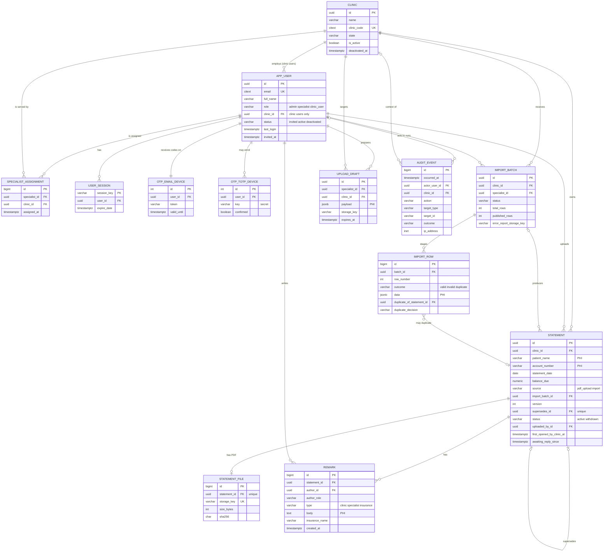

# Backend Schema: My Patient

| | |
|---|---|
| **Product** | My Patient (patient statement portal) |
| **Company** | US24 Solutions |
| **Version** | v1 |
| **Document status** | Draft for review |
| **Date** | October 21, 2026 |
| **Inputs** | 01-prd.md, 02-trd.md, 03-app-flow.md (approved) |
| **Target platform** | PostgreSQL 17 on Amazon RDS, Django 5.2 LTS ORM, Amazon S3 (TRD 1) |

### How to read this document
- Requirement IDs (F-x, FR-x, NFR-x) come from the PRD; screen IDs (A1, P2, S5…) and issue IDs (I-xx) from the App Flow; TRD section numbers are given as "TRD x.y".
- **[Proposed I-xx]** marks a column or rule that exists only because of an App Flow proposal that is not yet approved. If the proposal is rejected, that item is removed; nothing else changes.
- **[Q-xx]** refers to the open questions in Section 15.3.
- Physical table names are given explicitly, because `user` is a reserved word in PostgreSQL and Django's default names (`accounts_user`) are harder to read in SQL and audit work.

---

## 1. Plain-English Data Overview

### 1.1 What the database holds
The portal stores six kinds of information:

1. **People and organisations.** US24 staff (Admins, Specialists) and clinic staff (Clinic Users) are **users**. Client practices are **clinics**. A clinic user belongs to exactly one clinic. A specialist is linked to the clinics they serve through **specialist assignments**.
2. **Sign-in state.** Each signed-in browser has a **session**. Each user has an **email code device** and, optionally, an **authenticator device** for 2-step verification. Failed password attempts are counted for the 15-minute **lockout**.
3. **Statements.** A **statement** is one patient's statement for one clinic on one date. It either comes with an uploaded **PDF file** or is created from a row in a spreadsheet **import**. Statements are never edited or deleted; a mistaken one is **withdrawn**, and a corrected one is published as a **new version** that points to the one it replaces.
4. **Work in progress.** Before anything is published, a specialist's single upload is held as an **upload draft** (S2 → S3), and a spreadsheet import is held as an **import batch** with one **import row** per spreadsheet line (S4 → S5). Drafts and staged rows are deleted once they have been published, cancelled or have expired.
5. **Conversation.** Each statement has a log of **remarks** (Clinic, Specialist or Insurance). Remarks can only be added, never changed.
6. **Accountability.** Every sign-in event, every view, upload, import, download, print, withdrawal and remark, every user and clinic change and every blocked access attempt becomes an **audit event**. Audit events can only be added, never changed.

Files (PDFs, import spreadsheets and error reports) live in a private S3 bucket; the database holds only a random storage key for each file.

### 1.2 Entities at a glance

| Entity | Table | Holds patient information (PHI)? | Changes allowed |
|---|---|---|---|
| User | `app_user` | No | Update; never deleted |
| Clinic | `clinic` | No | Update; never deleted |
| Specialist assignment | `specialist_assignment` | No | Insert, delete |
| Session | `user_session` | No (session data holds IDs only) | Insert, update, delete (expiry) |
| Email code device | `otp_email_emaildevice` (django-otp) | No | Managed by library |
| Authenticator device | `otp_totp_totpdevice` (django-otp) | No (holds a secret key) | Insert, delete |
| Lockout counter | `axes_accessattempt` (django-axes) | No | Managed by library |
| Statement | `statement` | **Yes** | Limited updates only (status, flags); never deleted |
| Statement file | `statement_file` | **Yes** (file contents, original file name) | Insert only |
| Upload draft | `upload_draft` | **Yes** | Insert, update, delete |
| Import batch | `import_batch` | File name only (may contain PHI) | Insert, status updates; never deleted |
| Import row | `import_row` | **Yes** | Insert, update decision, delete |
| Remark | `remark` | **Yes** (free text) | Insert only |
| Audit event | `audit_event` | **No** (IDs only, by rule) | Insert only |

### 1.3 Relationships in one paragraph
A **clinic** has many **clinic users** and many **statements**. **Specialists** and **clinics** are linked many-to-many through **specialist assignments**. A **statement** has at most one **file**, many **remarks**, and may **supersede** exactly one earlier statement. An **import batch** belongs to one clinic and one specialist, has many staged **import rows** and produces many **statements**. Every **audit event** points to the user who acted (when known), the clinic involved (when there is one) and the record acted on.

---

## 2. Conventions

| Topic | Rule | Why |
|---|---|---|
| **Primary keys** | `uuid` (v4, generated by the app) for records whose IDs appear in page addresses: `app_user`, `clinic`, `statement`, `upload_draft`, `import_batch`. `bigint` identity for internal records: `specialist_assignment`, `statement_file`, `import_row`, `remark`, `audit_event`. | Random IDs in URLs stop anyone from guessing neighbouring records. This is defence in depth on top of the server-side access checks (FR-2.5). |
| **Timestamps** | `timestamptz`, stored in UTC; default `now()` where noted | TRD Q8: stored and exported in UTC, shown in the browser's time zone. No per-user time zone column is needed. |
| **Money** | `numeric(12,2)`; never floating point | Exact cents (FR-8.1, FR-8.2). |
| **Dates** | `date` for statement dates, date of birth and dates of service | No time component exists in the source data. |
| **Emails** | `citext` (case-insensitive text), max 254 characters, stored trimmed and lower-cased | One account per email regardless of case (FR-1.1, M6 duplicate check). |
| **Enumerations** | `varchar` with a `CHECK` constraint listing allowed values (Django `TextChoices`) | Readable in SQL and audits; simpler migrations than PostgreSQL enum types. |
| **Text limits** | Every free-text column has a maximum length enforced by a `CHECK` | Prevents abuse and matches form validation. |
| **Foreign keys** | `ON DELETE RESTRICT` everywhere unless stated | Users, clinics and statements are never deleted (FR-4.4, FR-4.6, NFR-5); RESTRICT makes an accidental delete fail loudly. |
| **Audit columns** | `created_at`, and `updated_at` where rows can change | Basic traceability; full history is in `audit_event`. |
| **Extensions** | `pg_trgm` (partial-match search), `citext` | FR-9.3 partial search; email uniqueness. |

---

## 3. Authentication and Session Model

### 3.1 Sign-in sequence and the data it touches

| Step | Screen | Data read | Data written |
|---|---|---|---|
| 1. Password step | A1 | `axes_accessattempt` (is this email locked?), `app_user` (password hash, status), `clinic.is_active` for clinic users | On failure: `axes_accessattempt` counter + `audit_event` (`auth.login.failure`; `auth.lockout` on the 5th). On success: new `user_session` row marked **password-verified only**; counter reset |
| 2. Send code | A1 → A2 | `otp_email_emaildevice` | New 6-digit token and `valid_until = now() + 10 min` on the device; `audit_event` (`auth.otp.sent`) |
| 3. Verify code | A2 | Device token / TOTP secret; failed-code counter in session data | On success: session marked **verified** (django-otp stores the device ID in the session); token cleared (single use); `auth.otp.success`. On failure: counter +1, `auth.otp.failure`; at 5, session deleted and `auth.otp.too_many` (FR-1.3) |
| 4. Every later request | All | `user_session` (expiry), `app_user.status`, `clinic.is_active` | Session expiry pushed to `now() + 15 min` on real user actions (FR-1.9) |
| 5. Sign out / timeout | Header, G1 | — | Session deleted; `auth.logout` or `auth.session_timeout` |

### 3.2 Rules carried by the data
- **Only fully active accounts can sign in.** `app_user.status = 'active'` (invited and deactivated users fail with the generic message, FR-1.10), and for clinic users `clinic.is_active = true` (FR-4.6).
- **2-step on every login (FR-1.4).** The "verified" flag lives only in the session, so every new session must verify again. No "remember device" data is stored.
- **Lockout by email, not by account (FR-1.5, [Proposed I-03]).** django-axes is configured to lock on the typed email (`AXES_LOCKOUT_PARAMETERS = ["username"]`), so an unknown email locks exactly like a real one and nothing reveals whether the account exists.
- **Immediate sign-out (FR-4.4, FR-4.6).** Sessions carry a `user_id` column, so deactivating a user, deactivating a clinic or resetting a password ends that user's sessions with one `DELETE FROM user_session WHERE user_id = …`, without decoding any session data.

### 3.3 Password-reset and invitation links (no token table)
Both links use **signed, stateless tokens** (TRD 3.4), so no token table is needed:

| Link | Signed over | Lifetime | Why it becomes single-use |
|---|---|---|---|
| Password reset (A3 → A4) | user ID, current password hash, `last_login`, timestamp | 30 min (FR-1.7) | Setting a new password changes the hash, which invalidates the token |
| Invitation (M6 → A5) | user ID, `status`, `invited_at`, timestamp | 72 h (FR-1.8) | Accepting changes `status`; **resending** updates `invited_at`, which invalidates the old link (M7) |

### 3.4 What is stored in session data
Only: the user ID, the verified-device ID, the failed-code counter for the current sign-in attempt, the CSRF secret and the last-activity time. **No patient data is ever placed in the session** (TRD 3.1).

---

## 4. User Roles and Permissions

### 4.1 Roles
Roles are a single column on `app_user` (`role`). Django's groups and per-object permission tables are **not** used: three fixed roles are simpler to reason about and test (TRD 2.2 `access` module).

| Role | Value | Clinic link | Lands on |
|---|---|---|---|
| Admin | `admin` | None (`clinic_id` must be NULL) | M1 |
| Specialist | `specialist` | Many clinics through `specialist_assignment`; `clinic_id` must be NULL | S1 |
| Clinic User | `clinic_user` | Exactly one clinic (`clinic_id` NOT NULL) | C1 |

### 4.2 Scope functions (implemented once, in the `access` module)
Every query for clinics, statements, remarks, files or imports is filtered through these definitions. A record outside scope returns **not found** and writes `access.blocked` (FR-2.5).

| Function | Admin | Specialist | Clinic User |
|---|---|---|---|
| `visible_clinics(u)` | All clinics | Clinics with a row in `specialist_assignment` for `u` | `{u.clinic_id}` if that clinic is active |
| `publishable_clinics(u)` | None (admins don't publish) | `visible_clinics(u)` where `clinic.is_active = true` [Proposed I-18] | None |
| `visible_statements(u)` | All statements | Statements in `visible_clinics(u)`, any status [Proposed I-08] | Statements in `u.clinic_id` with `status = 'active'` (FR-9.1, FR-10.4) |
| `visible_import_batches(u)` | None [Q-11] | Batches where `specialist_id = u.id` and clinic in `visible_clinics(u)` | None |

---

## 5. Table-by-Table Schema

Notation: **NN** = NOT NULL. "Check" = database `CHECK` constraint. All checks are also enforced in Django forms so users get friendly messages.

### 5.1 `clinic`
**Purpose:** a client practice (FR-4.1). **Screens:** M2, M3, M4; clinic name on S1–S6, P1, P2.

| Column | Type | NN | Default | Validation / notes |
|---|---|---|---|---|
| `id` | uuid | ✓ | app-generated | PK |
| `name` | varchar(200) | ✓ | | 1–200 chars, trimmed |
| `clinic_code` | citext | ✓ | | The PRD's "clinic ID" (FR-4.1). 1–32 chars; letters, digits, `-`, `_`. **Unique** (case-insensitive). Shown in Plex Mono in the UI |
| `address_line1` | varchar(200) | ✓ | | |
| `address_line2` | varchar(200) | | NULL | |
| `city` | varchar(100) | ✓ | | |
| `state` | char(2) | ✓ | | US state code, upper case (assumption A-5) |
| `postal_code` | varchar(10) | ✓ | | `^\d{5}(-\d{4})?$` |
| `contact_name` | varchar(200) | ✓ | | Primary contact (FR-4.1, M4) |
| `contact_phone` | varchar(32) | ✓ | | Stored as entered, digits validated (10 digits after stripping) |
| `contact_email` | citext | ✓ | | Valid email, ≤ 254 |
| `is_active` | boolean | ✓ | `true` | FR-4.1, FR-4.6 |
| `deactivated_at` | timestamptz | | NULL | Check: `is_active = (deactivated_at IS NULL)` |
| `deactivated_by_id` | uuid → `app_user.id` | | NULL | Set with `deactivated_at` |
| `created_at` | timestamptz | ✓ | `now()` | |
| `created_by_id` | uuid → `app_user.id` | ✓ | | Admin who created it |
| `updated_at` | timestamptz | ✓ | `now()` | |

**Indexes:** unique (`clinic_code`); btree (`is_active`, `lower(name)`) for M2 list and filter; GIN trigram on `lower(name)` for M2 search.
**Relationships:** 1 clinic → many `app_user` (clinic users); many-to-many with specialists via `specialist_assignment`; 1 → many `statement`, `import_batch`, `upload_draft`.
**Delete:** never (RESTRICT). Deactivate instead.

---

### 5.2 `app_user`
**Purpose:** every person who can sign in (FR-2.1, FR-4.2). Custom Django user model built on `AbstractBaseUser` (no Django admin permission tables). **Screens:** A1–A6, header (N2), M5–M7.

| Column | Type | NN | Default | Validation / notes |
|---|---|---|---|---|
| `id` | uuid | ✓ | app-generated | PK |
| `email` | citext | ✓ | | **Unique**. Sign-in identifier (FR-1.1) |
| `full_name` | varchar(200) | ✓ | | Shown top-left (N2) and on remarks (FR-11.2) |
| `role` | varchar(16) | ✓ | | Check in (`admin`, `specialist`, `clinic_user`) |
| `clinic_id` | uuid → `clinic.id` | | NULL | Check: `(role = 'clinic_user') = (clinic_id IS NOT NULL)` (FR-2.2) |
| `status` | varchar(16) | ✓ | `'invited'` | Check in (`invited`, `active`, `deactivated`) (M5, M7) |
| `is_active` | boolean | ✓ | `false` | Django's sign-in flag. Check: `is_active = (status = 'active')` |
| `password` | varchar(128) | ✓ | unusable | Django PBKDF2/Argon2 hash. Unusable (`!`-prefixed) until the invitation is accepted |
| `last_login` | timestamptz | | NULL | "Last sign-in" on M5, M7 |
| `invited_at` | timestamptz | ✓ | `now()` | Updated on resend; part of the invitation token (Section 3.3) |
| `invited_by_id` | uuid → `app_user.id` | | NULL | NULL only for the first admin (Section 11) |
| `activated_at` | timestamptz | | NULL | Set when A5 is completed |
| `deactivated_at` | timestamptz | | NULL | Check: `(status = 'deactivated') = (deactivated_at IS NOT NULL)` |
| `deactivated_by_id` | uuid → `app_user.id` | | NULL | |
| `created_at` | timestamptz | ✓ | `now()` | |
| `updated_at` | timestamptz | ✓ | `now()` | |

**Indexes:** unique (`email`); btree (`clinic_id`, `status`) for M3 user list; btree (`role`, `status`) for M5 filters and the last-admin check; GIN trigram on `lower(full_name)` and on `email` for M5 search.
**Relationships:** many clinic users → 1 `clinic`; specialists ↔ clinics via `specialist_assignment`; 1 user → many `user_session`, `remark`, `audit_event`, `statement` (as uploader).
**Delete:** never (FR-4.4). Deactivate instead.
**Not stored:** time zone, phone, avatar, preferences (no requirement).

---

### 5.3 `specialist_assignment`
**Purpose:** which clinics each specialist serves (FR-2.3, FR-4.3). **Screens:** M3, M7, S1 "My clinics".

| Column | Type | NN | Default | Validation / notes |
|---|---|---|---|---|
| `id` | bigint identity | ✓ | | PK |
| `specialist_id` | uuid → `app_user.id` | ✓ | | Must be a user with `role = 'specialist'` (enforced by trigger `trg_assignment_role_check` and in the app) |
| `clinic_id` | uuid → `clinic.id` | ✓ | | |
| `assigned_at` | timestamptz | ✓ | `now()` | |
| `assigned_by_id` | uuid → `app_user.id` | ✓ | | The admin |

**Constraints:** **unique** (`specialist_id`, `clinic_id`).
**Indexes:** the unique index serves "my clinics"; btree (`clinic_id`) for M3 "assigned specialists".
**Delete:** **hard delete on unassign** (FR-4.3). Access ends immediately because every request re-checks this table. The history lives in `audit_event` (`assignment.delete`).

---

### 5.4 `user_session`
**Purpose:** server-side sessions that can be ended at once (FR-1.9, FR-4.4, TRD 3.4). Custom Django session model (`AbstractBaseSession`) with an extra user column.

| Column | Type | NN | Default | Validation / notes |
|---|---|---|---|---|
| `session_key` | varchar(40) | ✓ | | PK (random, from Django) |
| `session_data` | text | ✓ | | Signed, encoded; contents listed in Section 3.4 |
| `expire_date` | timestamptz | ✓ | | Sliding: `now() + 15 min` on each real action |
| `user_id` | uuid → `app_user.id` | | NULL | NULL before the password step succeeds |
| `created_at` | timestamptz | ✓ | `now()` | |

**Indexes:** btree (`user_id`) for "end all sessions of this user"; btree (`expire_date`) for cleanup.
**Delete:** on sign-out, timeout, deactivation, clinic deactivation, password reset; expired rows purged by `clearsessions` (Section 10.2).

---

### 5.5 Library-managed authentication tables
These tables come from the libraries chosen in TRD 3.5. Their structure is owned by the library; the configuration below is what the requirements need.

| Table | Library | Use | Required configuration |
|---|---|---|---|
| `otp_email_emaildevice` | django-otp | One per user; holds the current 6-digit email code and its expiry | `OTP_EMAIL_TOKEN_VALIDITY = 600` s (FR-1.3); token cleared on successful use; generation cooldown 60 s if "Resend code" is approved [Proposed I-02]. Created when the invitation is accepted |
| `otp_totp_totpdevice` | django-otp | Optional authenticator app (FR-1.2) | `confirmed = true` only after A6 succeeds; **deleted** by "Reset 2-step" (FR-4.5). The secret key is sensitive (Section 13.3, Q-6) |
| `axes_accessattempt` | django-axes | Failed-password counter per typed email | `AXES_FAILURE_LIMIT = 5`, `AXES_COOLOFF_TIME = 15 min`, lock on username only, reset on success (FR-1.5). Access logs disabled (`AXES_DISABLE_ACCESS_LOG = True`) because `audit_event` is the record of truth |

The 5-wrong-codes rule (FR-1.3) is counted **per sign-in attempt** in the session, not on the device, so it resets with a fresh password step as the PRD describes.

---

### 5.6 `statement`
**Purpose:** one patient statement for one clinic (FR-8.1, FR-8.2). **Screens:** S3 (create), S5/S6 (create in bulk), P1, P2, P3, C1 (New count), S1.

| Column | Type | NN | Default | Validation / notes |
|---|---|---|---|---|
| `id` | uuid | ✓ | app-generated | PK |
| `clinic_id` | uuid → `clinic.id` | ✓ | | FR-8.1 |
| `patient_name` | varchar(200) | ✓ | | 1–200 chars, trimmed. **PHI** |
| `account_number` | varchar(64) | ✓ | | 1–64 chars; stored as given, trimmed. **PHI** |
| `statement_date` | date | ✓ | | Not in the future (+1 day tolerance for time zones) |
| `balance_due` | numeric(12,2) | ✓ | | Negative allowed for credits [Q-2] |
| `patient_dob` | date | | NULL | Optional (FR-8.2). Before `statement_date`. **PHI** |
| `service_date_from` | date | | NULL | "Dates of service" (FR-8.2) as a range [Q-1]. **PHI** |
| `service_date_to` | date | | NULL | Check: both NULL, or `from <= to` |
| `cpt_codes` | varchar(10)[] | | NULL | Each element `^[0-9A-Z]{5}$` (5-character CPT/HCPCS) [Q-1] |
| `billed_amount` | numeric(12,2) | | NULL | ≥ 0 |
| `insurance_paid` | numeric(12,2) | | NULL | ≥ 0 |
| `adjustments` | numeric(12,2) | | NULL | Any sign |
| `insurance_name` | varchar(200) | | NULL | |
| `source` | varchar(16) | ✓ | | Check in (`pdf_upload`, `import`) (F7, F8) |
| `import_batch_id` | uuid → `import_batch.id` | | NULL | Check: `(source = 'import') = (import_batch_id IS NOT NULL)` |
| `import_row_number` | integer | | NULL | Spreadsheet row it came from; set with `import_batch_id` (traceability for FR-7.6 and FR-13.1 "imports") |
| `version` | integer | ✓ | `1` | ≥ 1 (FR-7.5) |
| `supersedes_id` | uuid → `statement.id` | | NULL | The earlier version this one replaces (FR-7.5). Check: `(version = 1) = (supersedes_id IS NULL)` |
| `status` | varchar(16) | ✓ | `'active'` | Check in (`active`, `withdrawn`) (FR-8.1) |
| `withdrawn_at` | timestamptz | | NULL | Check: `(status = 'withdrawn')` ⇔ `withdrawn_at`, `withdrawn_by_id` and `withdrawal_reason` all NOT NULL |
| `withdrawn_by_id` | uuid → `app_user.id` | | NULL | Specialist (FR-10.4) |
| `withdrawal_reason` | varchar(1000) | | NULL | 1–1000 chars. **May contain PHI** |
| `uploaded_by_id` | uuid → `app_user.id` | ✓ | | Specialist who published (FR-8.1) |
| `uploaded_at` | timestamptz | ✓ | `now()` | "Upload date and time" (FR-8.1) |
| `first_opened_by_clinic_at` | timestamptz | | NULL | NULL = **New** badge (FR-9.2, FR-10.2, N4) |
| `last_remark_at` | timestamptz | | NULL | **Derived.** Maintained in the remark transaction (Section 8, T8); feeds "last remark date" on P1 (FR-9.2) |
| `awaiting_reply_since` | timestamptz | | NULL | **Derived.** Time of the oldest clinic remark not yet followed by a specialist remark; NULL when answered (FR-11.7, FR-5.1) |
| `created_at` | timestamptz | ✓ | `now()` | |
| `updated_at` | timestamptz | ✓ | `now()` | |

**Constraints**
- **Unique** (`supersedes_id`) where NOT NULL: a statement can be superseded only once, so versions form a single chain.
- **Immutability trigger** `trg_statement_immutable`: after insert, only `status`, `withdrawn_*`, `first_opened_by_clinic_at`, `last_remark_at`, `awaiting_reply_since` and `updated_at` may change; any other column change raises an error (PRD A10, 9.2 "editing statement data after publishing" excluded). `DELETE` is refused.

**Indexes**
| Index | Serves |
|---|---|
| btree (`clinic_id`, `status`, `statement_date` DESC, `id`) | P1 default list, newest first, 25 per page (FR-9.1, 9.4, 9.5) |
| btree (`clinic_id`, `status`, `lower(patient_name)`) | P1 sort by patient name |
| btree (`clinic_id`, `status`, `balance_due`) | P1 sort by balance |
| GIN trigram (`lower(patient_name)`) | Partial-name search (FR-9.3, TRD 2.3) |
| GIN trigram (`lower(account_number)`) | Partial account-number search (FR-9.3) |
| btree (`clinic_id`, `account_number`, `statement_date`) | Duplicate detection (FR-7.5, I-11) and "other statements for this patient" (FR-10.3) |
| partial btree (`clinic_id`) WHERE `status = 'active' AND first_opened_by_clinic_at IS NULL` | New count on C1 |
| partial btree (`clinic_id`, `awaiting_reply_since`) WHERE `awaiting_reply_since IS NOT NULL` | S1 unanswered remarks |
| partial btree (`uploaded_by_id`, `uploaded_at` DESC) WHERE `source = 'pdf_upload'` | S1 recent single uploads |
| btree (`import_batch_id`) | S6 and provenance |

**Relationships:** many → 1 `clinic`; 1 → 0..1 `statement_file`; 1 → many `remark`; 0..1 → 0..1 `statement` (supersedes); many → 0..1 `import_batch`.
**Delete:** never. Withdraw instead.

---

### 5.7 `statement_file`
**Purpose:** the PDF attached to a single-upload statement (F7, FR-6.2). One-to-one with `statement`. Imported statements have no row here; their PDF is generated on demand from the statement data (FR-7.8) and **not stored**.

| Column | Type | NN | Default | Validation / notes |
|---|---|---|---|---|
| `id` | bigint identity | ✓ | | PK |
| `statement_id` | uuid → `statement.id` | ✓ | | **Unique** (one-to-one) |
| `storage_key` | varchar(255) | ✓ | | **Unique**. `statements/{yyyy}/{mm}/{uuid}.pdf` (Section 9). Never derived from the file name or patient |
| `original_filename` | varchar(255) | ✓ | | As uploaded; shown on S3. **May contain PHI**; never used in storage keys or logs |
| `content_type` | varchar(32) | ✓ | `'application/pdf'` | Check: = `'application/pdf'` |
| `size_bytes` | integer | ✓ | | Check: 1 – 10,485,760 (FR-6.2) |
| `sha256` | char(64) | ✓ | | Lower-case hex; integrity check on download |
| `created_at` | timestamptz | ✓ | `now()` | |

**Delete:** never; insert-only (the app role has no UPDATE or DELETE grant).

---

### 5.8 `upload_draft`
**Purpose:** hold a single upload between S2 (details and PDF) and S3 (confirm), so that "Back to edit" keeps the values and nothing is visible to the clinic until confirmed (FR-6.3, FR-6.4).

| Column | Type | NN | Default | Validation / notes |
|---|---|---|---|---|
| `id` | uuid | ✓ | app-generated | PK; appears in the S3 confirm URL |
| `specialist_id` | uuid → `app_user.id` | ✓ | | Owner; only they can see or publish it |
| `clinic_id` | uuid → `clinic.id` | ✓ | | Must be in `publishable_clinics` at create **and** at publish |
| `payload` | jsonb | ✓ | | Validated statement fields (same names and rules as `statement`). **PHI** |
| `storage_key` | varchar(255) | ✓ | | `drafts/{uuid}.pdf` |
| `original_filename` | varchar(255) | ✓ | | **May contain PHI** |
| `size_bytes` | integer | ✓ | | 1 – 10,485,760 |
| `sha256` | char(64) | ✓ | | |
| `created_at` | timestamptz | ✓ | `now()` | |
| `expires_at` | timestamptz | ✓ | `now() + 24 h` | After this the draft cannot be published |

**Indexes:** btree (`specialist_id`, `created_at`); btree (`expires_at`) for cleanup.
**Delete:** **hard delete** when published (T3), cancelled (S2 Cancel) or expired. The S3 object under `drafts/` is removed by an S3 lifecycle rule after 1 day (Section 9). Drafts are not statements, so the 7-year retention (NFR-5) does not apply; deleting them follows the minimum-necessary rule (NFR-4).

---

### 5.9 `import_batch`
**Purpose:** one spreadsheet import for one clinic, from check to result (FR-7.1–7.7). **Screens:** S4, S5, S6, S1 recent imports.

| Column | Type | NN | Default | Validation / notes |
|---|---|---|---|---|
| `id` | uuid | ✓ | app-generated | PK; appears in S5/S6 URLs |
| `clinic_id` | uuid → `clinic.id` | ✓ | | One clinic per file (FR-7.1) |
| `specialist_id` | uuid → `app_user.id` | ✓ | | Who ran it |
| `original_filename` | varchar(255) | ✓ | | Shown on S5/S6. **May contain PHI** |
| `file_format` | varchar(8) | ✓ | | Check in (`xlsx`, `csv`) |
| `size_bytes` | integer | ✓ | | Check: 1 – 10,485,760 (TRD 6.1) |
| `sha256` | char(64) | ✓ | | |
| `source_storage_key` | varchar(255) | ✓ | | `imports/source/{batch_id}.{ext}` |
| `status` | varchar(24) | ✓ | | Check in (`failed`, `previewed`, `published`, `partially_imported`, `cancelled` [Proposed I-12]) |
| `failure_reason` | varchar(500) | | NULL | File-level reason (wrong type, empty, > 5,000 rows, missing columns). Check: `(status = 'failed') = (failure_reason IS NOT NULL)`. Contains column names only, never row data |
| `total_rows` | integer | | NULL | ≤ 5,000 (FR-7.7) |
| `valid_rows` | integer | | NULL | |
| `invalid_rows` | integer | | NULL | |
| `duplicate_rows` | integer | | NULL | |
| `published_rows` | integer | | NULL | Set at publish |
| `published_new_versions` | integer | | NULL | Set at publish |
| `skipped_duplicates` | integer | | NULL | Set at publish |
| `error_report_storage_key` | varchar(255) | | NULL | `imports/error-reports/{batch_id}.csv`; NULL when no failed rows (FR-7.6) |
| `created_at` | timestamptz | ✓ | `now()` | |
| `checked_at` | timestamptz | | NULL | |
| `published_at` | timestamptz | | NULL | Check: set ⇔ status in (`published`, `partially_imported`) |
| `cancelled_at` | timestamptz | | NULL | [Proposed I-12] |
| `preview_expires_at` | timestamptz | | NULL | `checked_at + 24 h` [Proposed I-12]; a `previewed` batch past this time is treated as `cancelled` |

**Status meaning:** `published` = every row in the file became a statement. `partially_imported` = at least one row was invalid or skipped as a duplicate [Q-8].
**Indexes:** btree (`specialist_id`, `created_at` DESC) for S1 recent imports; btree (`clinic_id`, `created_at` DESC); btree (`status`, `preview_expires_at`) for cleanup.
**Delete:** never; kept as the record of each import (FR-13.1, FR-7.6). Counts survive after the staging rows are removed.

---

### 5.10 `import_row`
**Purpose:** staging table for the preview step (FR-7.3–7.5). Holds each parsed spreadsheet row between S4 and S5.

| Column | Type | NN | Default | Validation / notes |
|---|---|---|---|---|
| `id` | bigint identity | ✓ | | PK |
| `batch_id` | uuid → `import_batch.id` | ✓ | | `ON DELETE CASCADE` (staging only) |
| `row_number` | integer | ✓ | | Spreadsheet row (header = row 1). **Unique** (`batch_id`, `row_number`) |
| `outcome` | varchar(16) | ✓ | | Check in (`valid`, `invalid`, `duplicate`) |
| `data` | jsonb | ✓ | | Parsed, normalised values (valid/duplicate rows) or raw cell text (invalid rows). **PHI** |
| `errors` | jsonb | | NULL | Array of `{field, message}`; required when `outcome = 'invalid'` |
| `duplicate_of_statement_id` | uuid → `statement.id` | | NULL | Required when `outcome = 'duplicate'` (FR-7.5) |
| `duplicate_decision` | varchar(16) | | NULL | Check in (`skip`, `new_version`); only for duplicates; all must be set before publish ([Proposed] S5) |

**Indexes:** unique (`batch_id`, `row_number`); btree (`batch_id`, `outcome`).
**Delete:** **hard delete of all rows** when the batch becomes `published`, `partially_imported`, `cancelled` or expires (T6, Section 10). The outcome is preserved in the batch counts, the error report file and `statement.import_batch_id` / `import_row_number`.

---

### 5.11 `remark`
**Purpose:** the remarks log for each statement (F11). **Screens:** P2, S1 (unanswered), P3 (optional in print).

| Column | Type | NN | Default | Validation / notes |
|---|---|---|---|---|
| `id` | bigint identity | ✓ | | PK; also the tie-breaker for ordering |
| `statement_id` | uuid → `statement.id` | ✓ | | |
| `author_id` | uuid → `app_user.id` | ✓ | | FR-11.2 |
| `author_role` | varchar(16) | ✓ | | **Snapshot** of the author's role when written (FR-11.2), so the record never changes meaning. Check in (`clinic_user`, `specialist`) [Proposed I-07: admins don't write remarks] |
| `type` | varchar(16) | ✓ | | Check in (`clinic`, `specialist`, `insurance`) (FR-11.3) |
| `body` | text | ✓ | | Check: `char_length(body) BETWEEN 1 AND 2000`, not only whitespace (FR-11.5). Plain text. **PHI** |
| `insurance_name` | varchar(200) | | NULL | Check: `(type = 'insurance') = (insurance_name IS NOT NULL)` (FR-11.4) |
| `insurance_reference` | varchar(100) | | NULL | Check: NULL unless `type = 'insurance'` |
| `created_at` | timestamptz | ✓ | `now()` | |

**Constraints**
- Check: `(type = 'clinic' AND author_role = 'clinic_user') OR (type IN ('specialist','insurance') AND author_role = 'specialist')` (FR-11.4).
- **Insert-only:** trigger `trg_remark_immutable` refuses UPDATE and DELETE, and the app role has no such grants (FR-11.6).
- Insert refused when the statement is withdrawn (trigger check) [Proposed I-09].

**Indexes:** btree (`statement_id`, `created_at`, `id`) for the log in order (FR-11.1) and for S1 excerpts.
**Delete:** never.

---

### 5.12 `audit_event`
**Purpose:** the tamper-resistant record of access and changes (F13, FR-13.1–13.4). **Screens:** M8 (read, filter, export); written by every screen.

| Column | Type | NN | Default | Validation / notes |
|---|---|---|---|---|
| `id` | bigint identity | ✓ | | PK |
| `occurred_at` | timestamptz | ✓ | `now()` | FR-13.2 "date and time" |
| `actor_user_id` | uuid → `app_user.id` | | NULL | NULL only for events with no known user (failed login for an unknown email, lockout) |
| `actor_role` | varchar(16) | | NULL | Snapshot (FR-13.2 "role") |
| `attempted_email` | citext | | NULL | Only for `auth.login.failure` / `auth.lockout` / `auth.password.reset_requested`; ≤ 254 [Q-9] |
| `clinic_id` | uuid → `clinic.id` | | NULL | Clinic of the target record, or of the actor for clinic users (FR-13.2 "clinic", M8 filter) |
| `action` | varchar(48) | ✓ | | Must be in the action catalogue below (check constraint) |
| `target_type` | varchar(24) | | NULL | Check in (`statement`, `statement_file`, `import_batch`, `remark`, `app_user`, `clinic`, `specialist_assignment`, `audit_event`, `url`) |
| `target_id` | varchar(64) | | NULL | ID of the record (FR-13.2 "target record"); for `url`, the route name only |
| `outcome` | varchar(16) | ✓ | `'success'` | Check in (`success`, `failure`, `blocked`) |
| `ip_address` | inet | | NULL | From the load balancer's forwarded header only (TRD 5.5) |
| `details` | jsonb | | NULL | **Allow-listed keys only**, never PHI: `include_remarks` (bool), `rows_total`, `rows_published`, `rows_failed`, `new_versions`, `skipped`, `changed_fields` (field **names** only), `filters` (M8 export: user/clinic/action/date IDs), `remark_type`, `method` (`email`/`totp`) |

**Action catalogue (FR-13.1)**

| Group | Actions |
|---|---|
| Sign-in | `auth.login.success`, `auth.login.failure`, `auth.lockout`, `auth.logout`, `auth.session_timeout`, `auth.otp.sent`, `auth.otp.success`, `auth.otp.failure`, `auth.otp.too_many`, `auth.totp.enrolled`, `auth.password.reset_requested`, `auth.password.reset_completed`, `auth.invitation.accepted` |
| Statements | `statement.view`, `statement.upload`, `statement.download`, `statement.print`, `statement.withdraw` |
| Imports | `import.check`, `import.publish`, `import.cancel` [Proposed I-12], `import.error_report.download` |
| Remarks | `remark.create` |
| Users and clinics | `user.invite`, `user.invite.resend`, `user.update`, `user.deactivate`, `user.otp_reset`, `clinic.create`, `clinic.update`, `clinic.deactivate`, `assignment.create`, `assignment.delete` |
| Access and audit | `access.blocked`, `audit.export` [Proposed I-20] |

**Constraints:** insert-only — trigger `trg_audit_immutable` refuses UPDATE, DELETE and TRUNCATE; the app role has only INSERT and SELECT (FR-13.4, TRD 5.5).
**Indexes:** btree (`occurred_at` DESC); btree (`actor_user_id`, `occurred_at` DESC); btree (`clinic_id`, `occurred_at` DESC); btree (`action`, `occurred_at` DESC); btree (`target_type`, `target_id`). These cover every M8 filter combination with date ranges.
**Volume:** roughly 4–5 million rows a year at 50 clinics, growing with clinic count. Plain table at launch; partitioning reviewed at ~100 million rows (risk R-1).
**Delete:** never (NFR-5: at least 7 years).

---

### 5.13 Relationship summary

| Type | Relationship | Implemented by |
|---|---|---|
| One-to-one | Statement ↔ its PDF file | `statement_file.statement_id` unique |
| One-to-one | Statement ↔ the statement it supersedes | `statement.supersedes_id` unique (partial) |
| One-to-one | User ↔ email code device | django-otp (one device created per user) |
| One-to-many | Clinic → clinic users | `app_user.clinic_id` |
| One-to-many | Clinic → statements, import batches, upload drafts | `clinic_id` on each |
| One-to-many | Statement → remarks | `remark.statement_id` |
| One-to-many | Import batch → import rows; import batch → statements | `import_row.batch_id`; `statement.import_batch_id` |
| One-to-many | User → sessions, remarks, uploaded statements, audit events, authenticator devices | FK columns on each |
| Many-to-many | Specialists ↔ clinics | `specialist_assignment` |

---

## 6. Entity-Relationship Diagram

`axes_accessattempt` is omitted from the diagram because it has no foreign keys (it is keyed by the typed email).

---

## 7. Access-Control Rules

### 7.1 Create / Read / Update / Delete by role
**Scope words** refer to Section 4.2. "—" means no access. "System" means the action happens automatically as part of another permitted action, never as a user's direct choice.

| Table | Admin | Specialist | Clinic User | System |
|---|---|---|---|---|
| `clinic` | **C R U** (all); deactivate = U; no D | **R** visible clinics (name, code, status only) | **R** own clinic (name only) | — |
| `app_user` | **C** (invite) **R U** (all); deactivate, resend, reset 2-step = U; no D | **R** self; **R** names of remark authors and uploaders in visible clinics | **R** self; **R** names of remark authors on visible statements | U `last_login`, `status` on invitation accept |
| `specialist_assignment` | **C R D** | **R** own rows | — | — |
| `user_session` | **D** (indirectly, by deactivation) | — | — | **C U D** own session |
| OTP devices | **D** TOTP of any user (reset 2-step) | **C** own TOTP (A6) | **C** own TOTP (A6) | **C U** email device; token rotation |
| `statement` | **R** all, any status [Proposed I-07, I-08] | **C** in publishable clinics; **R** visible statements; **U** withdraw only, own clinics' active statements | **R** visible statements (active, own clinic) | **U** `first_opened_by_clinic_at`, `last_remark_at`, `awaiting_reply_since` |
| `statement_file` | **R** (download) | **C** with statement; **R** visible | **R** visible | — |
| `upload_draft` | — | **C R U D** own drafts only | — | **D** expired |
| `import_batch` | — [Q-11] | **C** in publishable clinics; **R** own batches; **U** status (publish, cancel) | — | **U** expire previews |
| `import_row` | — | **C** (via check); **R** own batches; **U** `duplicate_decision` while `previewed` | — | **D** after terminal status |
| `remark` | **R** all [Proposed I-07: no C] | **C** types `specialist`, `insurance` on visible, active statements; **R** visible | **C** type `clinic` on visible statements; **R** visible | — |
| `audit_event` | **R** all; export | — | — | **C** only |

**No role has UPDATE or DELETE on `remark`, `audit_event` or `statement_file`, or DELETE on `statement`, `app_user` or `clinic`.**

### 7.2 Write-time rules (checked in the same transaction as the write)
| Rule | Requirement |
|---|---|
| A specialist may publish (S3, S5) only if an assignment row exists **and** the clinic is active at the moment of commit | FR-6.1, App Flow S3/S5 edge cases |
| A clinic user may only add `clinic` remarks; a specialist only `specialist` / `insurance` | FR-11.4 |
| Remarks cannot be added to withdrawn statements | [Proposed I-09] |
| Withdraw only an `active` statement; a second withdraw returns "already withdrawn" | FR-10.4, App Flow D1 |
| An upload draft or import batch can only be read or published by the specialist who created it | Minimum necessary (NFR-4) |
| An admin cannot deactivate themselves or the last active admin | [Proposed I-19] |
| `app_user.clinic_id` must point to an active clinic when inviting | [Proposed] M6 |

### 7.3 Database-level enforcement (defence in depth)
The application connects with a restricted role; migrations run with a separate owner role.

| Role | Rights |
|---|---|
| `mypatient_owner` | Owns all objects; runs migrations (one-off ECS task, TRD 9). Never used by the running app |
| `mypatient_app` | SELECT, INSERT, UPDATE on most tables. **INSERT, SELECT only** on `remark`, `audit_event`, `statement_file`. **No DELETE** on `statement`, `app_user`, `clinic`, `import_batch`, `remark`, `audit_event`, `statement_file`. DELETE allowed only on `specialist_assignment`, `user_session`, `upload_draft`, `import_row`, OTP device tables and axes tables |
| `mypatient_readonly` | SELECT on non-PHI tables plus `audit_event`; for support queries and incident review (NFR-8). Optional |

Triggers (`trg_statement_immutable`, `trg_remark_immutable`, `trg_audit_immutable`, `trg_assignment_role_check`) apply even to the owner role, so a mistaken manual statement fails. As the TRD notes, someone with full database-owner rights could still disable a trigger (TRD 10, FR-13.4 partial).

---

## 8. Important Data Operations and Transaction Boundaries

Every operation below runs in **one database transaction** that includes its audit event, so an action cannot succeed without its audit record (TRD 5.5). Emails are sent **after commit** (`transaction.on_commit`), so a failed email never rolls back data and a rolled-back action never sends an email.

| # | Operation | Screen | Inside the transaction | Concurrency / idempotency |
|---|---|---|---|---|
| T1 | Password step | A1 | Check lockout → verify password → reset counter → create session (unverified) → generate email code → audit `auth.login.success`, `auth.otp.sent` | Lockout counter update is atomic in axes |
| T2 | Verify code | A2 | Check token / TOTP → mark session verified → clear token → set `last_login` → audit | Token cleared in the same statement that validates it (single use, FR-1.3) |
| T3 | Publish single upload | S3 | `SELECT … FROM upload_draft WHERE id = ? AND specialist_id = ? FOR UPDATE` → re-check assignment and clinic active → insert `statement` → insert `statement_file` → delete draft → audit `statement.upload` | The draft row lock makes a double-click publish once; the second request finds no draft and is redirected to the statement (S3 edge case) |
| T3a | S3 file move | S3 | **Before** the transaction: copy `drafts/{id}.pdf` → `statements/…/{uuid}.pdf`. **After** commit: delete the draft object (also covered by lifecycle) | If the transaction fails, the copied object is an orphan with no DB row; a weekly reconciliation report lists them (R-3) |
| T4 | Import check | S4 | Parse and validate the file **outside** the transaction (CPU work). Then one transaction: insert `import_batch` (`previewed` or `failed`) → bulk insert `import_row` (≤ 5,000, `COPY` or `bulk_create`) → audit `import.check` | Duplicate lookup uses one query per 1,000 rows against the (`clinic_id`, `account_number`, `statement_date`) index (TRD 6.1) |
| T5 | Choose duplicate actions | S5 | `UPDATE import_row SET duplicate_decision = ? WHERE batch_id = ? AND …` where the batch is `previewed` and owned by the user | Rejected once the batch has left `previewed` |
| T6 | Publish import | S5 | `SELECT … FROM import_batch WHERE id = ? AND status = 'previewed' FOR UPDATE` → re-check assignment, clinic active, preview not expired, every duplicate decided → for `new_version` rows lock the latest statement in each chain `FOR UPDATE` and insert with `version + 1`, `supersedes_id` → bulk insert all statements → write error report to S3 (before commit; failure aborts) → update batch counts and status → delete `import_row` rows → audit `import.publish` (one event with counts) | Status check under lock makes publish happen once. If someone else superseded the same statement in the meantime, the new row chains to the newest version |
| T7 | View statement | P2 | Scope check → audit `statement.view` → if clinic user: `UPDATE statement SET first_opened_by_clinic_at = now() WHERE id = ? AND first_opened_by_clinic_at IS NULL` | The conditional update is safe under concurrent opens |
| T8 | Add remark | P2 | `SELECT … FROM statement WHERE id = ? FOR UPDATE` → scope and status check → insert `remark` → set `last_remark_at = now()` → if type `clinic` and `awaiting_reply_since IS NULL`: set it to now; if author is specialist: set it to NULL → audit `remark.create` | The statement lock keeps the two derived columns consistent when a clinic user and a specialist post at the same moment |
| T9 | Withdraw | D1 | `SELECT … FOR UPDATE` → require `status = 'active'` → update status and `withdrawn_*` → audit `statement.withdraw` | Second request sees `withdrawn` → "already withdrawn" |
| T10 | Download / print | P2, P3, S6 | Scope check → audit `statement.download` / `statement.print` / `import.error_report.download` → commit → **then** stream the file | Audit is committed before any content leaves (TRD 5.5) |
| T11 | Invite user | M6 | Insert `app_user` (`invited`, unusable password) → audit `user.invite` → on commit send invitation | Unique email index rejects duplicates (M6) |
| T12 | Accept invitation | A5 | Validate token → set password, `status = 'active'`, `activated_at` → create email device → audit `auth.invitation.accepted` | Token becomes invalid once status changes |
| T13 | Deactivate user | M7 / D2 | Last-admin check (`SELECT … FROM app_user WHERE role = 'admin' AND status = 'active' FOR UPDATE`) → update status → `DELETE FROM user_session WHERE user_id = ?` → audit `user.deactivate` | Assignments are kept so reactivation [Proposed I-16] restores access |
| T14 | Deactivate clinic | M3 / D2 | Update clinic → delete sessions of all its clinic users → audit `clinic.deactivate` | Users keep `status = 'active'`; they are blocked by the clinic check (FR-4.6) |
| T15 | Assign / unassign specialist | M3, M7 | Insert or delete `specialist_assignment` → audit | Unique constraint prevents double assignment |
| T16 | Reset 2-step | M7 / D2 | Delete the user's TOTP devices → audit `user.otp_reset` | |
| T17 | Audit export | M8 | Audit `audit.export` with the filters, commit, then stream CSV from a read-only query | Large exports streamed with a server-side cursor |

---

## 9. File-Storage Structure

### 9.1 Buckets
One private bucket per environment, in that environment's AWS account (TRD 8): `us24-mypatient-{env}-files`.

| Setting | Value | Requirement |
|---|---|---|
| Block Public Access | All four settings on | TRD 5.2 |
| Object ownership | Bucket owner enforced (no ACLs) | |
| Encryption | SSE-KMS with an environment-specific customer-managed key; bucket key enabled | NFR-1 |
| Versioning | On | TRD 6.2 |
| Access | Only the app's IAM task role; TLS-only bucket policy (`aws:SecureTransport`) | NFR-1, TRD 5.7 |
| Object metadata and tags | **Never contain PHI** (no names, account numbers, file names) | NFR-4 |

### 9.2 Key layout

| Prefix | Content | Written by | Retention / lifecycle |
|---|---|---|---|
| `drafts/{draft_uuid}.pdf` | PDF waiting for S3 confirmation | S2 | **Expire after 1 day** (current and non-current versions) |
| `statements/{yyyy}/{mm}/{uuid}.pdf` | Published PDFs (`statement_file.storage_key`) | T3 | Never expire. Transition to a cheaper storage class after 365 days (TRD 6.3) |
| `imports/source/{batch_uuid}.{xlsx\|csv}` | The original import file | T4 | Kept for the retention period [Q-4] |
| `imports/error-reports/{batch_uuid}.csv` | Failed rows with reasons, formula-safe (TRD 5.4) | T6 | Kept for the retention period [Q-4] |

- **Not stored in S3:** generated standard-layout PDFs (FR-7.8) and print views; both are rendered on request. Audit exports are streamed, not stored.
- **Keys are random UUIDs**; the year/month folder only spreads objects out and holds no meaning.
- **Download file names** are set in the HTTP response, not in S3 (default: `statement-{statement_date}.pdf`) [Q-7].

---

## 10. Delete and Retention Behaviour

### 10.1 Per table

| Data | Delete behaviour | Retention |
|---|---|---|
| `app_user` | Never deleted; deactivated (FR-4.4) | Indefinite; needed to interpret remarks and audit for 7+ years |
| `clinic` | Never deleted; deactivated (FR-4.6) | Indefinite |
| `specialist_assignment` | Hard delete on unassign | History in `audit_event` |
| `statement` | Never deleted; withdrawn (FR-10.4) | ≥ 7 years (NFR-5); no automatic deletion (TRD 6.3) |
| `statement_file` + S3 object | Never deleted | ≥ 7 years |
| `remark` | Never deleted or edited (FR-11.6) | ≥ 7 years |
| `audit_event` | Never deleted or edited (FR-13.4) | ≥ 7 years |
| `import_batch` | Never deleted | ≥ 7 years (record of imports) |
| `import_row` | Deleted when the batch reaches a final state or its preview expires | Hours to 1 day |
| `upload_draft` + `drafts/` object | Deleted on publish, cancel or after 24 h | ≤ 1 day |
| `user_session` | Deleted on sign-out, timeout, deactivation; expired rows purged | Minutes |
| OTP devices | TOTP deleted on reset; email device kept for the user's lifetime | — |
| `axes_accessattempt` | Reset on successful login; stale rows purged after the cool-off | ≤ 1 day |
| Database backups | RDS automated backups with point-in-time recovery | 35 days (TRD 6.2) |

**After 7 years:** deletion is a manual, documented process for a later release (TRD 6.3). The schema supports it because every PHI row is reachable by `clinic_id` and date.

### 10.2 Cleanup tasks
The TRD has no background job system. The cleanups above need to run regularly:

| Task | Command |
|---|---|
| Purge expired sessions | `manage.py clearsessions` |
| Purge expired upload drafts | `manage.py purge_upload_drafts` |
| Expire stale import previews and delete their rows | `manage.py expire_import_previews` |
| Purge stale lockout rows | `manage.py axes_reset_failure_logs --age 1` |
| Report S3 objects with no DB row (no automatic delete) | `manage.py reconcile_storage` (weekly) |

**Recommended:** run them as one scheduled ECS task (Amazon EventBridge Scheduler, nightly). This is a small addition to the TRD's deployment, not a job queue. Alternative with no new infrastructure: run each cleanup opportunistically at sign-in and at the start of each upload or import. See Q-5.

---

## 11. Seed Data and Migrations

### 11.1 Seed data

| Environment | What is seeded | How |
|---|---|---|
| **Production** | **No patient data, no default passwords, no demo users.** Only the first Admin account | One-off command `manage.py create_first_admin --email … --name …` run as an ECS task; it creates an `invited` admin and sends the invitation email. `invited_by_id` is NULL for this one user |
| Staging and local | Synthetic data only (TRD 7): 3 clinics (one deactivated), 1 admin, 3 specialists with overlapping assignments, 2–3 clinic users per clinic, ~2,000 statements with obviously fake names, PDF and import sources, a withdrawn statement, a two-version chain, remarks of every type including an unanswered one, one import batch of each status | `manage.py seed_demo`. **Refuses to run** when `ENVIRONMENT=production` |
| All | No reference data tables are needed: roles, statuses, remark types and audit actions are code-level choices backed by `CHECK` constraints | — |

The **import template** (FR-7.2) is a static file in the repository, versioned with the code, not a database record.

### 11.2 Migrations

| Migration | Content |
|---|---|
| `0001_extensions` | `CREATE EXTENSION IF NOT EXISTS pg_trgm; CREATE EXTENSION IF NOT EXISTS citext;` (run as the owner role; supported on RDS) |
| `0002_roles_and_grants` | `mypatient_app` and `mypatient_readonly` grants (Section 7.3). Role creation itself is done in Terraform |
| `0003_core_tables` | `clinic`, `app_user`, `specialist_assignment`, `user_session` with all checks and indexes |
| `0004_library_tables` | django-otp and django-axes migrations (library-provided) |
| `0005_statements` | `statement`, `statement_file`, `upload_draft` |
| `0006_imports` | `import_batch`, `import_row` |
| `0007_remarks_and_audit` | `remark`, `audit_event` |
| `0008_triggers` | Immutability and role-check triggers (`RunSQL` with reverse SQL) |

**Rules**
- Migrations are forward-only in production and **backward-compatible** (add first, remove in a later release), so rolling back the app is always safe (TRD 9).
- Indexes added to large tables after launch use `AddIndexConcurrently` to avoid locking.
- Triggers and grants are in migrations, so every environment matches and tests run against the same protections.
- CI runs `makemigrations --check` and applies all migrations to a fresh PostgreSQL 17 database before tests.

---

## 12. Performance Notes
- **P1 list (NFR-13):** index (`clinic_id`, `status`, `statement_date` DESC, `id`) supports keyset or offset pagination of 25 rows per page; search uses the trigram indexes, then filters by clinic.
- **S1 unanswered remarks:** a partial index on `awaiting_reply_since` keeps the dashboard fast as remark volume grows; the remark list for each flagged statement uses (`statement_id`, `created_at`).
- **Import (NFR-14):** validation in memory; one bulk insert per publish; duplicate lookups batched.
- **Derived columns** (`last_remark_at`, `awaiting_reply_since`) can be rebuilt at any time from `remark` with `manage.py rebuild_statement_flags` if they ever drift.

---

## 13. Privacy and Security Considerations

### 13.1 Where patient information lives
| Location | PHI | Control |
|---|---|---|
| `statement` patient columns, `withdrawal_reason` | Yes | Scope functions; no DELETE grant; immutability trigger |
| `remark.body` | Yes (free text) | Insert-only |
| `upload_draft.payload`, `import_row.data` | Yes | Owner-only access; deleted within a day |
| `statement_file.original_filename`, `upload_draft.original_filename`, `import_batch.original_filename` | Possibly | Never used in storage keys, logs or audit details |
| S3 objects | Yes | Private bucket, SSE-KMS, app role only |
| `audit_event` | **No**, by design | `details` keys allow-listed; IDs only |
| `user_session.session_data` | No | Only IDs and counters |
| Application logs | No | TRD 5.6 logging filter |

### 13.2 Database settings that protect PHI
- **Encryption at rest** with KMS for RDS storage, snapshots and backups (NFR-1); TLS required for every connection (`rds.force_ssl = 1`).
- **No query parameters in database logs:** set `log_parameter_max_length = 0` and `log_parameter_max_length_on_error = 0`, and keep `log_statement = 'none'`. Otherwise slow-query and error logs would copy patient names and account numbers into CloudWatch.
- **Restores** go only into an isolated account or VPC; production data never enters staging (TRD 8).

### 13.3 Secrets inside the database
- **Password hashes:** Django's PBKDF2 (default) or Argon2.
- **Authenticator secrets** (`otp_totp_totpdevice.key`) are stored as plain hex by django-otp. Disk encryption covers backups, but a database read would expose them. Recommendation: wrap the key with application-level encryption (a KMS-backed data key) [Q-6].
- **Email codes** are short-lived (10 min) and cleared on use.

### 13.4 Other safeguards
- UUIDs in URLs prevent ID guessing; scope checks prevent access (FR-2.5).
- Audit rows are written in the same transaction as the action; audit failure blocks the action.
- `attempted_email` in `audit_event` may capture a mistyped password if a user types it into the email field; values longer than 254 characters or without `@` are stored as NULL [Q-9].

---

## 14. Traceability

| Table / object | PRD requirements | App Flow screens |
|---|---|---|
| `clinic` | F5, FR-4.1, FR-4.6, FR-2.2, FR-2.3 | M2, M3, M4, D2; clinic names on S1–S6, P1, P2 |
| `app_user` | F1, F5, FR-1.1, FR-1.8, FR-2.1, FR-2.2, FR-4.2, FR-4.4, FR-4.5, N2 | A1, A5, M5, M6, M7, D2, header |
| `specialist_assignment` | FR-2.3, FR-4.3, FR-5.1, FR-6.1 | M3, M7, S1, S2, S4 |
| `user_session` | FR-1.4, FR-1.9, FR-4.4, FR-4.6 | All signed-in screens, G1 |
| `otp_email_emaildevice` | F2, FR-1.2, FR-1.3 | A2 |
| `otp_totp_totpdevice` | FR-1.2, FR-4.5 | A2, A6, M7 |
| `axes_accessattempt` | FR-1.5, FR-1.10 | A1 |
| Signed reset / invite tokens (no table) | F3, FR-1.7, FR-1.8 | A3, A4, A5, M7 |
| `statement` | F7, F8, F9, F10, FR-6.4, FR-7.5, FR-8.1, FR-8.2, FR-9.1–9.5, FR-10.1–10.4, FR-11.7, N4 | S3, S5, S6, P1, P2, P3, D1, C1, S1 |
| `statement_file` | F7, FR-6.2, FR-10.1, FR-12.1 | S2, S3, P2 |
| `upload_draft` | FR-6.1, FR-6.3, FR-6.4 | S2, S3 |
| `import_batch` | F8, FR-5.1, FR-7.1, FR-7.4, FR-7.6, FR-7.7 | S4, S5, S6, S1 |
| `import_row` | FR-7.3, FR-7.4, FR-7.5 | S5 |
| `remark` | F11, FR-11.1–11.7, FR-5.1, FR-5.3, FR-12.2 | P2, P3, S1 |
| `audit_event` | F13, FR-1.5, FR-2.5, FR-12.3, FR-13.1–13.4, NFR-5 | M8; written from every screen |
| S3 bucket | F7, F8, FR-6.2, FR-7.6, FR-12.1, NFR-1, NFR-5 | S2, S3, S4, S6, P2 |
| DB roles and triggers | FR-11.6, FR-13.4, A10, NFR-4 | — |

**Items not in the schema, because no requirement needs them:** notifications, patient or insurance-company accounts, remark attachments, payments, analytics tables, AR Report and Clinic Collection data, user preferences or time zones, multi-clinic users (all excluded in PRD 9.2).

---

## 15. Assumptions, Risks and Open Questions

### 15.1 Assumptions
| ID | Assumption | Affects |
|---|---|---|
| A-1 | "The same patient" (FR-10.3) means the **same account number within the same clinic** | `statement` index; P2 "other statements" |
| A-2 | The statement field list is provisional until US24's real export is reviewed (PRD Q1) | `statement` optional columns, `import_row.data` |
| A-3 | "Dates of service" is a single range per statement and CPT codes are a simple list; there are no line items in v1 | `service_date_from/to`, `cpt_codes` |
| A-4 | Balances may be negative (credits) | `balance_due` check |
| A-5 | All clinics are in the United States | `clinic.state`, `postal_code` |
| A-6 | App Flow proposals I-03, I-07, I-08, I-09, I-10, I-12, I-18, I-19 and I-20 are adopted as written | Items marked [Proposed] |
| A-7 | A specialist's remark of either type (Specialist or Insurance) answers a clinic remark (FR-11.7 says "a specialist adds a remark") | `awaiting_reply_since` logic |
| A-8 | One audit event per import publish (with counts) is enough for FR-13.1 "imports"; individual statements are traceable through `import_batch_id` | `audit_event` volume |

### 15.2 Risks
| ID | Risk | Impact | Mitigation |
|---|---|---|---|
| R-1 | `audit_event` grows to hundreds of millions of rows over 7 years at 500 clinics | Slower M8 queries and exports | Date-led indexes now; plan monthly partitioning before ~100 M rows |
| R-2 | Derived columns on `statement` drift from the remark log | Wrong New/unanswered indicators | Updated only inside T8 under a row lock; rebuild command (Section 12) |
| R-3 | S3 and the database are not in one transaction | Orphan files, or (worse) a row without a file | Copy file **before** commit; weekly reconciliation report; integrity hash on download |
| R-4 | A 5,000-row publish holds row locks for several seconds | Brief waits for remarks on superseded statements | Lock only superseded statements; bulk insert; measured in the CI timing test |
| R-5 | Authenticator secrets stored in plain hex | A database read exposes 2-step secrets | Application-level encryption (Q-6) |
| R-6 | PHI in free text (remarks, withdrawal reasons, file names) | PHI ends up in places assumed to be clean | Never copy these into logs or audit; treat them as PHI everywhere |
| R-7 | Cleanup tasks don't run (no scheduler) | Drafts and staging rows with PHI linger | Scheduled task (Q-5) plus S3 lifecycle on `drafts/` |
| R-8 | The database owner role can bypass triggers | Audit and remark immutability not absolute | Owner credentials restricted and rotated; optional write-once export (TRD Q5) |

### 15.3 Unresolved questions

| ID | Question | Default used in this schema |
|---|---|---|
| **Q-1** | What columns does US24's statement export contain (PRD Q1)? Are there line items (one row per service) rather than one row per statement? | Statement-level fields only; line items would add a child table |
| **Q-2** | Can a balance due be negative (a credit)? | Yes |
| **Q-3** | Is the account number the reliable patient identifier for "other statements for this patient" (FR-10.3)? | Yes (A-1) |
| **Q-4** | How long should original import files and error reports be kept? They contain PHI but document what was imported | 7 years, like statements |
| **Q-5** | Approve a nightly scheduled ECS task for cleanups, or use opportunistic cleanup only? | Scheduled task |
| **Q-6** | Should authenticator secrets be encrypted with an application-level key? | Yes (recommended) |
| **Q-7** | What file name should downloaded statements have? Including the patient's name helps clinics but leaves PHI in Downloads folders | `statement-{statement_date}.pdf` |
| **Q-8** | Does "Partially imported" include imports where the only missing rows were duplicates the specialist chose to skip? | Yes |
| **Q-9** | Should the audit log keep the email typed in failed sign-ins for unknown accounts? | Yes, with the safeguards in Section 13.4 |
| **Q-10** | App Flow blocking issues I-07 (admin actions on statements), I-08 (where withdrawn statements appear) and I-10 (how old versions are shown) | Schema supports the proposed answers; I-07 changes the `remark.author_role` check, I-08 changes only scope rules, I-10 needs no schema change |
| **Q-11** | Should admins be able to see import batches (S6) for oversight? No screen gives them access today | No |
