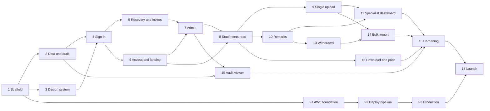

# Implementation Plan: My Patient

| | |
|---|---|
| **Product** | My Patient (patient statement portal) |
| **Company** | US24 Solutions |
| **Version** | v1 |
| **Document status** | Draft for approval — **no code has been written** |
| **Date** | October 21, 2026 |
| **Inputs** | 01-prd.md, 02-trd.md, 03-app-flow.md, 04-ui-ux-brief.md, 05-backend-schema.md (approved) |
| **Audience** | An AI coding agent working phase by phase, with a human reviewer approving each phase |

### How to read this document
- **Section 1** records what exists today and the stack the plan follows.
- **Section 2** lists contradictions and missing information found across the five documents, with the default the plan uses. **Read this before approving.**
- **Section 3** gives the phase order and dependency map.
- **Section 4** describes each phase in the same format: goal, coverage, scope, files, states, tests, completion criteria, risks and rollback.
- **Section 5** is the traceability table (every PRD feature → phase → test).
- **Section 6** is the recommended first phase. **The agent must stop after this plan and wait for approval before coding.**
- IDs: F-x, FR-x, NFR-x (PRD); TRD x.y; screens A1–G3 and issues I-xx (App Flow); DF-xx (UI/UX brief); tables and T-x operations, Q-xx (Backend Schema).

---

## 1. Starting Point

### 1.1 Existing project inspection
The working folder was inspected on October 21, 2026:

| Check | Result |
|---|---|
| Source code (`manage.py`, `pyproject.toml`, `package.json`) | **None found** |
| Git repository | **None** |
| Existing conventions to reuse | **None**; only the planning documents exist |
| Attached repositories | None |

**Conclusion:** this is a **greenfield build**. The plan follows the TRD stack exactly; there is no existing stack to reuse or conflict with. If a repository is later attached, Phase 1 must be re-checked against it before any code is written.

### 1.2 Stack the plan follows (TRD 1, 3)
Python 3.13 · Django 5.2 LTS · PostgreSQL 17 · server-rendered templates + HTMX · Tailwind CSS (standalone CLI) · django-otp · django-axes · pwned-passwords-django · django-storages + boto3 (S3) · django-ses · openpyxl · pypdf · WeasyPrint · django-csp · whitenoise · psycopg 3 · uv · ruff · djlint · mypy · pytest · factory_boy · Playwright + axe-core · Docker Compose (PostgreSQL, Mailpit) · Terraform · GitHub Actions · AWS (ECS Fargate, RDS, S3, SES, WAF, Secrets Manager, CloudWatch).

### 1.3 Proposed repository layout
```
my-patient/
├── pyproject.toml · uv.lock · .python-version · manage.py
├── config/                     # settings (base, local, test, staging, production), urls, wsgi
├── apps/
│   ├── core/                   # shared: storage wrapper, email sender, PHI-safe logging, middleware, formatting
│   ├── accounts/               # app_user, sessions, sign-in, 2-step, reset, invitation   (TRD 2.2)
│   ├── clinics/                # clinic, specialist_assignment
│   ├── access/                 # scope functions, role guards, blocked-access handling
│   ├── statements/             # statement, statement_file, upload_draft, list/detail/print/download
│   ├── imports/                # import_batch, import_row, parsing, preview, publish
│   ├── remarks/                # remark, ledger
│   ├── dashboard/              # C1, S1, M1
│   ├── audit/                  # audit_event, writer service, M8
│   └── ui/                     # component templates and template tags
├── templates/                  # base.html, components/, errors/
├── static/                     # src/tailwind.css, fonts/, js/, img/
├── tests/                      # unit + integration per app, access_matrix/, e2e/ (Playwright), perf/
├── docker-compose.yml · Dockerfile
├── .github/workflows/          # ci.yml, deploy.yml
├── infra/terraform/            # modules/, envs/staging/, envs/production/
└── docs/                       # 01–06 documents, decisions log, runbooks
```

---

## 2. Contradictions and Missing Information

Reviewing the five documents together surfaced the items below. None stops the project from starting, but several block a specific phase. **The plan uses the stated default unless you override it.**

### 2.1 Contradictions between approved documents

| ID | Contradiction | Documents | Default used in this plan | Blocks phase |
|---|---|---|---|---|
| **C-1** | The TRD says "no background jobs", but the schema needs regular cleanup of sessions, drafts, import staging and lockout rows (Schema Q-5). | TRD 1 vs Schema 10.2 | Cleanup **management commands** are built in the app; they run **opportunistically** (at sign-in and at the start of each upload/import) **and** from one nightly scheduled ECS task added in the infrastructure track. | 16, I-2 |
| **C-2** | The TRD sets `X-Frame-Options: DENY`, but P2 shows the PDF embedded in the page (App Flow I-14, UI DF-14). | TRD 5.3 vs App Flow P2, UI 7.12 | `DENY` everywhere **except** the statement-PDF view endpoint, which sends `SAMEORIGIN` and CSP `frame-ancestors 'self'`. Displaying the PDF in the page is audited as `statement.view`; the Download button is audited as `statement.download`. | 8 |
| **C-3** | The PRD (F14) and TRD 6.4 test at **375 px**; the UI brief requires **320 px** for WCAG reflow (DF-04). | PRD F14, TRD 6.4 vs UI 10.1 | Build and test from **320 px**. | 3 onward |
| **C-4** | The TRD limits JavaScript to the session warning and print button, but the UI brief and App Flow also need: password show/hide, remark character counter, dialogs, search debounce, file-name display, and **browser-time-zone formatting** (TRD Q8). | TRD 3.1 vs UI 7.4, 7.9; TRD Q8 | Allow a **small set of first-party JS modules**, served from `static/js/`, no inline scripts (CSP-safe), each with a no-JS fallback. HTMX is **vendored** (not loaded from a CDN). | 3 |
| **C-5** | The brief orders the home cards AR Report, Clinic Collection, **Patient Statement**; the UI brief recommends Patient Statement **first** on every screen size (DF-02). | Brief/PRD N1 vs UI DF-02 | **Patient Statement first**, same order in the DOM and visually. | 6 |
| **C-6** | The PRD gives "statement list/detail/remarks/download" to Clinic Users and Specialists only; App Flow I-07 and the schema add **read-only Admin access**. | PRD F9–F12 vs App Flow I-07, Schema 4.2 | Admins can view, download and print; **cannot** upload, withdraw or add remarks. | 8 |
| **C-7** | The App Flow print view (P3) cannot reliably print an uploaded PDF (I-15); the PRD expects printing "the statement". | PRD FR-12.2 vs App Flow I-15 | P3 prints the summary, fields and (optionally) remarks, with the note "Original PDF: use Download PDF to print it". | 12 |
| **C-8** | The UI brief requires **tagged, accessible PDFs** for generated statements; the TRD chose WeasyPrint, whose PDF/UA support must be verified for the pinned version. | UI 12.1 vs TRD 3.5 | Verify in Phase 12 with a spike. If WeasyPrint cannot produce tagged output, the HTML statement remains the accessible version and the gap is recorded. | 12 |
| **C-9** | The TRD lists Django's default database sessions; the schema needs a custom session model with a `user_id` column so sessions can be ended per user. | TRD 2.3 vs Schema 5.4 | Custom session model as in the schema (a refinement, not a change of technology). | 2 |
| **C-10** | The schema requires database settings that stop query parameters (patient names) reaching CloudWatch logs; the TRD does not mention them. | Schema 13.2 vs TRD 5.6 | Added to the RDS parameter group in the infrastructure track. | I-1 |

### 2.2 Missing information and pending decisions
Defaults below come from the earlier documents. Items marked **Needs your input** have no safe default.

| ID | Decision | Source | Default / status | Needed before phase |
|---|---|---|---|---|
| **D-1** | Statement field list and **import template columns and date format** | PRD Q1, UI DF-13, Schema Q-1 | **Needs your input.** Plan builds with the provisional schema fields and an ISO date format (`YYYY-MM-DD`) in the template | 8 (fields), 14 (template) |
| **D-2** | Are there statement **line items** (one row per service)? | Schema Q-1 | Assumed **no** | 8 |
| **D-3** | Can a balance be **negative** (credit)? | Schema Q-2 | Yes | 8 |
| **D-4** | Look of the **standard statement layout** for imported rows | PRD Q5 | **Needs your input.** A clean provisional layout is built from the UI brief | 12 |
| **D-5** | **Logo files** (SVG, full colour and single colour) | UI DF-11 | **Needs your input.** A text placeholder "US24 Solutions" is used until supplied | 3 (placeholder), 17 (final) |
| **D-6** | Specialist **name shown to clinics** on remarks and "Published by" | PRD Q2 | Full name with role label "US24 Specialist" | 10 |
| **D-7** | Authenticator **entry point** | App Flow I-01 | Offered after a successful email code on A2 | 5 |
| **D-8** | Lockout **message** | App Flow I-03 | Generic "Too many attempts. Try again in 15 minutes." for any email | 4 |
| **D-9** | Where staff see **withdrawn** statements | App Flow I-08 | Status filter on P1 for staff | 13 |
| **D-10** | How **older versions** appear | App Flow I-10 | Both visible; older labelled "Earlier version" and linked | 14 |
| **D-11** | **Cancelled** import status and 24 h preview expiry | App Flow I-12 | Adopted | 14 |
| **D-12** | Encrypt **authenticator secrets** | Schema Q-6 | Yes, with an app-level key from Secrets Manager | 5 |
| **D-13** | Download **file name** | Schema Q-7 | `statement-{statement_date}.pdf` | 12 |
| **D-14** | Retention of **import source files and error reports** | Schema Q-4 | 7 years | 14 |
| **D-15** | Remaining App Flow proposals (I-02, I-04, I-05, I-06, I-09, I-11, I-13, I-16–I-27) and TRD defaults Q1–Q10 | App Flow 5, TRD 13 | Adopted as written | Various (noted per phase) |
| **D-16** | **AWS accounts, BAA, DNS for us24solutions.com, SES production access** | TRD 4, 8, Q2 | **Needs your action** (not code). Required for the infrastructure track | I-1 |
| **D-17** | Who will **build and maintain** (TRD Q1) — if the team prefers another stack, this plan must be redone | TRD Q1 | Python/Django as planned | Before Phase 1 |

---

## 3. Phase Order

### 3.1 Two tracks
- **Build track (Phases 1–16):** everything an AI coding agent can build and verify locally with Docker Compose and in CI, using synthetic data only.
- **Infrastructure track (I-1 to I-3):** AWS, Terraform and deployment. Needs human-owned AWS accounts and credentials (D-16). It can start any time after Phase 1 and must finish before Phase 17.
- **Phase 17** is launch readiness (security test, restore drill, usability test, production go-live) and depends on both tracks.

### 3.2 Phase list

| # | Phase | Size | Depends on | Main outcome |
|---|---|---|---|---|
| 1 | Repository, tooling and CI scaffold | S | — | Runnable empty app; CI green |
| 2 | Data foundation and audit writer | M | 1 | Core tables, DB protections, audit service |
| 3 | Design system and base layout | M | 1 | Tokens, components, header, error pages |
| 4 | Sign-in: password, email code, lockout, sessions | M | 2, 3 | A1, A2, G1, sign-out |
| 5 | Recovery, invitations and authenticator app | M | 4 | A3–A6, first-admin command |
| 6 | Access control and role landing pages | M | 4 | `access` module, C1/S1/M1 shells, G2 logging, access-matrix harness |
| 7 | Admin: clinics, users, assignments | L | 5, 6 | M2–M7, D2 |
| 8 | Statements: storage, seed data, list and detail (read) | L | 6, 7 | P1, P2 (read), New badge |
| 9 | Single statement upload | M | 8 | S2, S3 |
| 10 | Remarks ledger | M | 8 | Remarks on P2; unanswered tracking |
| 11 | Specialist dashboard | S | 9, 10 | Full S1 |
| 12 | Download, print and generated PDF | M | 8 | Download, P3, standard layout PDF |
| 13 | Withdrawal and staff statement views | S | 10 | D1, withdrawn banner, status filter |
| 14 | Bulk import | L | 9, 13 | S4, S5, S6, versions |
| 15 | Audit log viewer and export | S | 2, 7 | M8 |
| 16 | Hardening: performance, accessibility, security, cleanup | M | 1–15 | All NFR checks pass locally/CI |
| I-1 | Infrastructure: AWS foundation (Terraform) | M | 1, D-16 | Staging network, RDS, S3, SES, secrets |
| I-2 | Infrastructure: ECS, WAF, CI/CD deploy, alarms, scheduled task | M | I-1 | Auto-deploy to staging |
| I-3 | Infrastructure: production environment | M | I-2 | Production ready (empty) |
| 17 | Launch readiness and go-live | M | 16, I-3 | Pen test, restore drill, UAT, go-live |

### 3.3 Dependency map


### 3.4 Rules that apply to every phase (Definition of Done)
1. **One phase = one or more small pull requests**, each reviewed by the human owner before merge.
2. **CI green:** ruff, djlint, mypy (main modules), pytest, `makemigrations --check`, bandit, pip-audit, gitleaks.
3. **Coverage:** ≥ 85% overall; ≥ 95% for `accounts`, `access`, `audit` (TRD 7).
4. **Access matrix updated** for every new URL (from Phase 6 on). A URL missing from the matrix fails CI.
5. **Audit events** for every action the phase adds, written in the same transaction (TRD 5.5, Schema 8).
6. **No PHI** in logs, emails, URLs, page titles, audit `details` or S3 keys (NFR-3, NFR-4, UI DF-06). Tests assert this where the phase touches PHI.
7. **Accessibility:** axe scan shows zero violations on every new page; keyboard path checked (NFR-12).
8. **Responsive:** each new page checked at 320, 375, 768 and 1280 px (C-3).
9. **All states built:** loading, empty, error and success states listed for the phase exist and are tested.
10. **Synthetic data only** in local, CI and staging (TRD 7).
11. **Docs updated:** decisions log, any new environment variable, and runbook notes.
12. **Rollback:** before go-live, rollback = revert the PR and reset the local database. After go-live, TRD 9 applies (redeploy previous task definition; migrations always backward-compatible).

---

## 4. Phases

### Phase 1 — Repository, tooling and CI scaffold
**Size:** S · **Depends on:** nothing · **Decisions:** D-17

**Goal and user-visible outcome**
An empty Django project that starts locally with one command, has a health endpoint, enforces the security baseline in settings, and runs a complete CI pipeline. No user-facing features yet; a developer sees a plain "My Patient" placeholder page and `/healthz` returns `ok`.

**PRD coverage:** foundations for NFR-1, NFR-4 (logging), NFR-11; TRD 3.5, 3.6, 5.3, 5.6, 5.7, 7.

**Scope**
- Project created with `uv`, Python 3.13 pinned; Django 5.2 LTS and every library in TRD 3.5 pinned. **Task:** confirm each library supports Django 5.2 / Python 3.13 before pinning; record versions in `docs/decisions.md`.
- Settings split: `base`, `local`, `test`, `staging`, `production`, read from environment variables (`django-environ`). `DEBUG` off outside local.
- Security baseline: HTTPS-only cookies, HSTS, `X-Frame-Options: DENY`, `Referrer-Policy: same-origin`, `nosniff`, CSP via django-csp (no inline scripts), `Cache-Control: no-store` middleware for authenticated responses (TRD 5.3).
- PHI-safe logging filter (allow-list of fields; drops request bodies and query strings) and structured JSON logs (TRD 5.6).
- Docker Compose: PostgreSQL 17 and Mailpit; `Dockerfile` for the app (non-root user, Gunicorn).
- Tooling: ruff, djlint, mypy + django-stubs, pytest + pytest-django + factory_boy + coverage, Playwright (installed, one smoke test), pre-commit with gitleaks.
- GitHub Actions `ci.yml`: lint → type-check → migrations check → tests with PostgreSQL service → bandit → pip-audit → gitleaks → build image (no push yet).
- `/healthz` endpoint (no database details exposed).
- Empty Django apps from the layout in 1.3, registered.

**Expected files / areas**
`pyproject.toml`, `uv.lock`, `manage.py`, `config/**`, `apps/*/__init__.py` and `apps.py`, `apps/core/logging.py`, `apps/core/middleware.py`, `docker-compose.yml`, `Dockerfile`, `.pre-commit-config.yaml`, `.github/workflows/ci.yml`, `tests/test_health.py`, `tests/e2e/test_smoke.py`, `README.md`, `docs/decisions.md`, `.env.example`, `.gitignore`.

**States:** not applicable (no user screens). `/healthz` returns 200 `ok` or 503 when the database is unreachable.

**Tests**
- Unit: settings load for each environment; security headers present on a response; logging filter strips a planted patient name and email from a log record.
- Integration: `/healthz` 200 with database up; 503 with database down.
- E2E: Playwright opens the placeholder page.
- Manual: `docker compose up` then `uv run manage.py runserver`; open `/healthz`; check response headers in the browser.

**Completion criteria**
- [ ] Fresh clone → running app in ≤ 3 commands, documented in README.
- [ ] CI pipeline passes on a pull request.
- [ ] Security headers verified by test.
- [ ] Library versions recorded with compatibility notes.

**Risks and rollback**
- A library may not yet support Django 5.2 / Python 3.13 → pick the nearest supported version or an alternative; record in decisions log and raise with the reviewer **before** continuing.
- Rollback: delete the branch; nothing depends on it yet.

---

### Phase 2 — Data foundation and audit writer
**Size:** M · **Depends on:** 1 · **Decisions:** C-9

**Goal and user-visible outcome**
The core tables exist with every constraint, trigger and database grant from the schema, and there is a single service for writing audit events. No screens; the outcome is verified by tests and by inspecting the database.

**PRD coverage:** FR-2.1, FR-2.2, FR-2.3, FR-4.4 (never delete users), FR-13.1–13.4 (writer and protection), NFR-5.

**Scope**
- **Data:** `clinic`, `app_user` (custom user on `AbstractBaseUser`, email as username, roles, status), `specialist_assignment`, `user_session` (custom session model with `user_id`), `audit_event` — all columns, checks, indexes per Schema 5.1–5.4, 5.12.
- **Migrations:** `0001_extensions` (`pg_trgm`, `citext`), `0002_roles_and_grants` (`mypatient_app`, `mypatient_readonly` grants; roles themselves created by Docker init script locally and Terraform later), core tables, `0008_triggers` for `trg_audit_immutable` and `trg_assignment_role_check` (statement and remark triggers come with their tables in later phases).
- **App connects as `mypatient_app`; migrations run as `mypatient_owner`** in every environment, including tests, so grants are always exercised.
- **Audit service** (`apps/audit/services.py`): `record(action, actor, target, clinic, outcome, details)` with the action catalogue (Schema 5.12) as an enum, `details` key allow-list, IP from the trusted forwarded header only, and `transaction.on_commit`-free design (written inside the caller's transaction).
- **Factories** for clinic, users of each role and assignments.

**Expected files / areas**
`apps/clinics/models.py`, `apps/accounts/models.py`, `apps/accounts/sessions.py`, `apps/audit/models.py`, `apps/audit/services.py`, `apps/audit/actions.py`, migrations in each app, `docker/postgres/init.sql`, `tests/factories.py`, `tests/audit/`, `tests/db/test_constraints.py`.

**States:** not applicable.

**Tests**
- Every check constraint rejects bad rows (role vs clinic, status vs `is_active`, email uniqueness case-insensitive, assignment of a non-specialist).
- `audit_event`: UPDATE, DELETE and TRUNCATE fail as the app role **and** via the trigger.
- App role cannot DELETE `app_user` or `clinic`.
- Audit writer rejects unknown actions and non-allow-listed `details` keys; writes IP only from the trusted header.
- A rolled-back transaction leaves no audit row.

**Completion criteria**
- [ ] Schema tables in this phase match 05-backend-schema.md column by column (reviewer checklist).
- [ ] All constraint and grant tests pass on real PostgreSQL 17 in CI.

**Risks and rollback**
- Custom user model must exist **before the first migration**; changing it later is costly. This is why it is in Phase 2.
- Grants in migrations can fail if roles are missing → Docker init script creates them locally; CI creates them in the service container.
- Rollback: reset the database; no production data exists.

---

### Phase 3 — Design system and base layout
**Size:** M · **Depends on:** 1 · **Decisions:** C-3, C-4, D-5 (placeholder logo)

**Goal and user-visible outcome**
The "Clinical Ledger" look is available as reusable templates: tokens, fonts, buttons, inputs, tables, badges, banners, dialogs, empty and loading states, the header and the error pages. A developer-only **component gallery** page (`/_dev/components`, local only) shows every component in every state.

**PRD coverage:** N2, N3 (header layout), F14, NFR-10, NFR-11, NFR-12; UI brief Sections 3–8, 10–12; G2, G3 screens.

**Scope**
- **Tailwind** standalone CLI (pinned), theme built from UI tokens (colours, type scale, spacing, radii, shadows, breakpoints).
- **Fonts:** IBM Plex Sans, IBM Plex Mono, Source Serif 4 as self-hosted WOFF2, `font-display: swap`.
- **Templates:** `base.html` (skip link, landmarks, `lang="en-US"`, page-title block without PHI), `auth_base.html` (logo-only header).
- **Components** (`templates/components/` + template tags): button variants and busy state, text/password/code/select/date/textarea/radio/checkbox/file inputs, error summary + inline errors, table with caption/sortable headers and mobile stacked rows, pagination, back link, breadcrumb, banners, badges (New, status, remark type, Coming soon), home card + disabled card, destination plate, empty state, skeleton, long-task indicator, dialog.
- **JS modules** (`static/js/`, no inline script, C-4): `dialog.js`, `password-toggle.js`, `char-counter.js`, `localtime.js` (formats `<time datetime>` in browser time zone with zone label; server falls back to UTC label), `debounce-search.js`. HTMX vendored and pinned.
- **Error pages:** G2 (`404.html`) and G3 (`500.html` with reference code from request ID).
- **Reduced motion** and **forced-colors** styles.
- Logo: text placeholder "US24 Solutions" until D-5 is supplied.

**Expected files / areas**
`static/src/tailwind.css`, `tailwind.config.js` (or v4 CSS config), `static/fonts/**`, `static/js/**`, `static/vendor/htmx.min.js`, `templates/base.html`, `templates/auth_base.html`, `templates/components/**`, `apps/ui/templatetags/ui.py`, `templates/errors/404.html`, `templates/errors/500.html`, `apps/ui/views.py` (dev gallery), `tests/ui/`, `tests/e2e/test_components_a11y.py`.

**States:** every component shows default, hover, focus-visible, active, selected, disabled, busy, error, read-only and empty states in the gallery (UI Section 8).

**Tests**
- Playwright + axe on the gallery and on G2/G3: zero violations.
- Visual check at 320, 375, 768, 1280 px: no horizontal scroll.
- Contrast: automated check of token pairs listed in UI 12.2.
- `localtime.js` unit test (formats a UTC timestamp in a given zone, keeps the zone label).
- Reduced-motion: spinner replaced by static icon (Playwright emulation).
- Manual: keyboard-only pass through the gallery; forced-colors check in a Chromium emulation.

**Completion criteria**
- [ ] Every component in UI Section 7 exists in the gallery with all states from Section 8.
- [ ] G2 and G3 render correctly and never echo the requested URL or record IDs.
- [ ] Gallery route returns 404 outside local settings.

**Risks and rollback**
- Tailwind standalone CLI version churn → pin the binary version in the Makefile/CI.
- Rollback: revert PR; later phases depend on it, so fix forward rather than revert once Phase 4 starts.

---

### Phase 4 — Sign-in: password step, email code, lockout and sessions
**Size:** M · **Depends on:** 2, 3 · **Decisions:** D-8, I-02 (resend), I-25

**Goal and user-visible outcome**
A user created by a test fixture can sign in with email and password, receive a 6-digit code in Mailpit, enter it, and reach a placeholder "signed in" page. Wrong passwords, lockout, wrong codes, sign-out and the 15-minute timeout with warning all behave as specified.

**PRD coverage:** F1, F2 (email path), FR-1.1–1.5, FR-1.9, FR-1.10, FR-4.4 (session ending), NFR-3; screens A1, A2, G1, header Sign out.

**Scope**
- **Data:** django-otp email device (`otp_email_emaildevice`), django-axes tables; settings: 10-minute code validity, 5-failure lock on username only, 15-minute cool-off, access logs off (Schema 5.5).
- **Services:** password step (T1), code send (on commit), verify (T2), per-attempt wrong-code counter in session (5 → back to A1), resend with 60 s cooldown (I-02), sign-out, sliding 15-minute expiry, "only active users at active clinics can sign in" check (clinic check activates once clinics have data).
- **Middleware:** "verified session required" — blocks every route except A1–A5, static files, `/healthz`.
- **Routes:** `/login` (A1), `/login/verify` (A2), `/logout`, `/session/keepalive` (POST, for G1 "Stay signed in"), `/session/status` (GET, returns seconds left; does **not** extend the session).
- **Components used:** auth layout, code input, banners, G1 dialog with countdown (announced at open, 60 s, 30 s).
- **Email templates:** code email with no PHI (NFR-3).
- **Audit:** `auth.login.success/failure`, `auth.lockout`, `auth.otp.sent/success/failure/too_many`, `auth.logout`, `auth.session_timeout`.

**Expected files / areas**
`apps/accounts/views/login.py`, `apps/accounts/services/auth.py`, `apps/accounts/middleware.py`, `apps/accounts/forms.py`, `apps/core/email.py`, `templates/accounts/login.html`, `templates/accounts/verify.html`, `templates/emails/code.*`, `templates/components/session_warning.html`, `static/js/session.js`, `tests/accounts/`, `tests/e2e/test_sign_in.py`.

**States**
| State | Behaviour |
|---|---|
| Loading | Sign in / Verify buttons disabled with busy label |
| Empty | Inline "Enter your email" / "Enter your password" / "Enter the 6-digit code" |
| Error | Generic credential error (FR-1.10); lockout message (D-8); wrong/expired code with tries left; email send failure message |
| Success | A2 after password; landing placeholder after code; signed-out and timed-out banners on A1 |

**Tests**
- Unit/integration: each PRD F1 and F2 acceptance criterion; generic messages identical for unknown email vs wrong password; similar response timing (no large difference); lockout after 5 failures for an **unknown** email too; code expires after 10 minutes (time-frozen test); code single use; 5 wrong codes returns to A1; deactivated user rejected; no page reachable without verification (crawl all registered URLs unauthenticated → redirected to A1); session expires after 15 minutes idle; keepalive extends; `session/status` does not extend.
- Audit completeness for every action added.
- E2E: full sign-in through Mailpit API; G1 appears with clock fast-forward; Escape = Stay signed in.
- Manual: sign in on a phone-width viewport; check numeric keypad; check email contains no PHI.

**Completion criteria**
- [ ] All F1 and F2 (email) acceptance criteria pass automatically.
- [ ] Middleware blocks every non-auth route when unverified.

**Risks and rollback**
- Timing differences can leak account existence → constant-time password check path for unknown users (Django's dummy hash) and test.
- Email delivery delays in production are an operational risk (TRD 10) → authenticator app in Phase 5.
- Rollback: revert PR; no data migrations beyond library tables.

---

### Phase 5 — Recovery, invitations and authenticator app
**Size:** M · **Depends on:** 4 · **Decisions:** D-7, D-12, I-26, TRD Q7

**Goal and user-visible outcome**
Users can reset a forgotten password, accept an invitation to set a first password, and optionally set up an authenticator app. An operator can create the first Admin with a command that sends an invitation.

**PRD coverage:** F2 (authenticator), F3, FR-1.2, FR-1.6, FR-1.7, FR-1.8, FR-4.5 (data side); screens A3, A4, A5, A6.

**Scope**
- **Token generators:** reset (30 min, signed over password hash and `last_login`), invitation (72 h, signed over status and `invited_at`) — no token table (Schema 3.3).
- **Password rules:** min 12, common-password list, HIBP range check via `pwned-passwords-django` with **fail-open** fallback (TRD Q7) and a log line (no password data).
- **Routes:** `/password/forgot` (A3), `/password/reset/<token>` (A4), `/invite/<token>` (A5), `/account/authenticator` (A6).
- **Authenticator:** TOTP device with QR (`qrcode`) and manual key; secret **encrypted** with an app-level key (D-12); A2 shows "Use your authenticator app instead" and defaults to the app when enrolled (I-25); offer A6 after a successful email code (D-7).
- **Reset effect:** ends all the user's sessions; still requires 2-step on next sign-in.
- **Command:** `manage.py create_first_admin --email --name` (Schema 11.1), refuses if an active admin exists.
- **Audit:** `auth.password.reset_requested/completed`, `auth.invitation.accepted`, `auth.totp.enrolled`.

**Expected files / areas**
`apps/accounts/tokens.py`, `apps/accounts/views/recovery.py`, `apps/accounts/views/invite.py`, `apps/accounts/views/authenticator.py`, `apps/accounts/validators.py`, `apps/accounts/crypto.py`, `apps/accounts/management/commands/create_first_admin.py`, templates for A3–A6 and emails, `tests/accounts/`, `tests/e2e/test_recovery.py`.

**States**
| State | Behaviour |
|---|---|
| Loading | Buttons busy |
| Empty | Field-level messages |
| Error | Same confirmation for any email on A3 (FR-1.10); expired/used link messages; password rule failures with reasons; wrong authenticator code ("check your phone's time") |
| Success | "Check your email" confirmation; "Password changed"/"Password set" banner on A1; authenticator enrolled message |

**Tests**
- All F3 acceptance criteria; reset link single use and expires at 30 min; invitation expires at 72 h; resend (simulated by updating `invited_at`) invalidates the old link; HIBP unreachable → basic checks still enforced and save allowed; TOTP enrolment and sign-in with app code; TOTP secret not stored in plain text (read raw column in test); `create_first_admin` refuses when an admin exists.
- E2E: invitation → A5 → A1 → A2 → landing.
- Manual: scan QR with a real authenticator app.

**Completion criteria**
- [ ] F2 TOTP criterion and all F3 criteria pass.
- [ ] First admin can be created and can sign in end to end locally.

**Risks and rollback**
- Encryption key loss would lock out authenticator users → document key rotation and the "Reset 2-step" fallback (email codes still work).
- Rollback: revert; the encrypted column is new, so no data conversion is needed.

---

### Phase 6 — Access control and role landing pages
**Size:** M · **Depends on:** 4 · **Decisions:** C-5, I-04, I-05, I-06

**Goal and user-visible outcome**
After signing in, each role lands on its own page: Clinic Users on the three-card home (C1), Specialists on a dashboard shell (S1), Admins on the admin hub (M1). Opening another role's page or an out-of-scope record shows "Page not found" and is logged. The logo returns each user to their home.

**PRD coverage:** F4, FR-2.1–2.5, FR-3.1–3.5, N1, N2, N3; screens C1, S1 (shell), M1, G2.

**Scope**
- **`access` module:** `visible_clinics`, `publishable_clinics`, `visible_statements` (stub until Phase 8), `visible_import_batches` (stub) — Schema 4.2; role decorators/mixins; a single `not_found_and_log()` helper writing `access.blocked`.
- **Clinic active check** at sign-in and on every request for clinic users (FR-4.6).
- **Header** with full name left, logo (home link) right, Sign out.
- **C1:** cards in order Patient Statement (links to `/statements`, page arrives in Phase 8), AR Report, Clinic Collection (disabled, "Coming soon") — C-5; New count shown once statements exist.
- **S1 shell:** title and empty states only ("You haven't been assigned to any clinics yet").
- **M1:** three hub cards (Clinics, Users, Audit log) linking to routes built in Phases 7 and 15 (hidden links return G2 until then).
- **Access-control matrix harness:** a test that enumerates every URL pattern, requires an entry in `tests/access_matrix/matrix.py` (role × ownership → allowed / not found), and fails on missing entries (TRD 7).

**Expected files / areas**
`apps/access/scopes.py`, `apps/access/guards.py`, `apps/access/views.py` (404 handler hook), `apps/dashboard/views.py`, `templates/dashboard/clinic_home.html`, `templates/dashboard/specialist_home.html`, `templates/dashboard/admin_home.html`, `templates/components/header.html`, `tests/access_matrix/**`, `tests/dashboard/`, `tests/e2e/test_landing.py`.

**States**
| State | Behaviour |
|---|---|
| Empty | S1: "not assigned" message with upload/import disabled; C1: no New count |
| Error | G2 for any blocked or unknown address (never reveals existence) |
| Success | Correct landing page per role |

**Tests**
- Access matrix runs green for all current URLs; adding a URL without a matrix entry fails.
- Clinic user cannot reach S1/M1 routes (G2 + `access.blocked`); specialist cannot reach M1; admin cannot reach S1 publishing routes.
- Disabled cards are not links, have `aria-disabled`, readable contrast; card order matches C-5.
- Clinic deactivation (via fixture) blocks the clinic's users on next request.
- E2E: each role signs in and lands correctly; logo returns home.

**Completion criteria**
- [ ] F4 criteria that can be tested without statements pass (role pages blocked, logging).
- [ ] N1, N2, N3 acceptance criteria pass.
- [ ] Matrix harness in CI.

**Risks and rollback**
- The `access` module is the main HIPAA control → 95% coverage minimum and reviewer sign-off required.
- Rollback: revert PR.

---

### Phase 7 — Admin: clinics, users and assignments
**Size:** L · **Depends on:** 5, 6 · **Decisions:** I-16, I-17, I-18, I-19

**Goal and user-visible outcome**
An Admin can create and edit clinics, invite users of any role, assign and unassign specialists, resend invitations, reset someone's authenticator, deactivate and reactivate users and clinics. Deactivation signs people out immediately.

**PRD coverage:** F5, FR-4.1–4.6, FR-1.8 (sending), US-05–US-07; screens M2–M7, D2.

**Scope**
- **Routes:** `/manage/clinics` (M2), `/manage/clinics/new` and `/<id>/edit` (M4), `/manage/clinics/<id>` (M3), `/manage/users` (M5), `/manage/users/invite` (M6), `/manage/users/<id>` (M7); POST actions for assign, unassign, deactivate, reactivate (I-16), resend invitation, reset 2-step.
- **Services:** T11 invite (email on commit), T13 deactivate user with last-admin/self guard (I-19), T14 deactivate clinic, T15 assign/unassign, T16 reset 2-step; name/email edits only, role/clinic changes via deactivate + re-invite (I-17).
- **Search and filters** on M2/M5 using trigram indexes.
- **Audit:** `user.invite`, `user.invite.resend`, `user.update`, `user.deactivate`, `user.otp_reset`, `clinic.create`, `clinic.update`, `clinic.deactivate`, `assignment.create`, `assignment.delete` (with `changed_fields` names only).
- **Emails:** invitation (no PHI).

**Expected files / areas**
`apps/clinics/views.py`, `apps/clinics/forms.py`, `apps/clinics/services.py`, `apps/accounts/views/admin_users.py`, `apps/accounts/services/admin.py`, `templates/manage/**`, `templates/emails/invitation.*`, `tests/clinics/`, `tests/accounts/test_admin_*.py`, `tests/e2e/test_admin.py`.

**States**
| State | Behaviour |
|---|---|
| Loading | Busy buttons; table busy on filter |
| Empty | "No clinics yet. Add your first clinic."; "No users yet."; "No specialist assigned…" |
| Error | Duplicate clinic code; duplicate email with link to user; Clinic User without clinic; last-admin block; email send failure ("Use Resend invitation") |
| Success | Persistent banners: "Clinic saved", "Invitation sent… expires in 72 hours", "Invitation resent", deactivated status badges |

**Tests**
- All F5 acceptance criteria; deactivation deletes sessions (integration test with two active sessions); unassign removes specialist access on the next request; invitation email contains no PHI; last admin cannot be deactivated; D2 dialogs: focus trap, Escape, backdrop does not close destructive dialogs.
- Access matrix entries for all new URLs (non-admins → G2).
- E2E: onboarding journey — create clinic → invite clinic user → accept → sign in.

**Completion criteria**
- [ ] F5 criteria pass; journey "Clinic onboarding" from App Flow 1.2 works end to end locally.

**Risks and rollback**
- Accidental mass deactivation → confirm dialogs and audit trail; reactivation exists (I-16).
- Rollback: revert PR (no schema changes in this phase beyond Phase 2).

---

### Phase 8 — Statements: storage, seed data, list and detail (read side)
**Size:** L · **Depends on:** 6, 7 · **Decisions:** D-1 (provisional fields), D-2, D-3, C-2, C-6

**Goal and user-visible outcome**
With synthetic seed data, a Clinic User can open Patient Statement, search, filter, sort, page through their clinic's statements, open one, see its fields and PDF, and see "Other statements for this patient". The **New** badge clears on first open. Specialists and Admins see the same pages for clinics in their scope.

**PRD coverage:** F9, F10 (read), FR-9.1–9.5, FR-10.1–10.3, FR-6.4/N4 (New badge), FR-2.5, FR-13.1 (views), US-17, US-18; screens P1, P2 (read), C1 New count.

**Scope**
- **Data:** `statement` and `statement_file` with all checks, indexes (including trigram) and `trg_statement_immutable` (Schema 5.6, 5.7).
- **Storage wrapper** (`apps/core/storage.py`): local disk in development, S3 in staging/production; random keys (`statements/{yyyy}/{mm}/{uuid}.pdf`); streaming read; SHA-256 check.
- **Seed command** `seed_demo` (Schema 11.1), refusing to run in production; generates ~2,000 statements with obviously fake names and dummy PDFs.
- **Routes:** `/statements` (clinic user P1), `/clinics/<clinic_id>/statements` (staff P1), `/statements/<id>` (P2), `/statements/<id>/file` (inline PDF for the embedded viewer, `SAMEORIGIN` only here — C-2).
- **P1:** search (debounced, HTMX), date range, sort, 25 per page, result count, search-match highlight, mobile stacked rows, filters kept in the URL (no PHI in URL: search text is allowed in the query string? **No** — see risk below).
- **P2 (read):** summary band, fields, PDF area (embedded from `lg`, View/Download block below), standard-layout placeholder for imported rows, other statements by account number, breadcrumbs for staff.
- **T7:** audit `statement.view`; clear New on first clinic-user open.
- **Admin access:** read-only (C-6) via M3 "View statements".

**Expected files / areas**
`apps/statements/models.py`, migrations (+ trigger), `apps/core/storage.py`, `apps/statements/queries.py`, `apps/statements/views/list.py`, `apps/statements/views/detail.py`, `apps/statements/management/commands/seed_demo.py`, `templates/statements/list.html`, `_rows.html`, `detail.html`, `tests/statements/`, `tests/e2e/test_find_statement.py`.

**States**
| State | Behaviour |
|---|---|
| Loading | Table busy indicator (HTMX), page skeleton on P2, "Can't display the PDF here" fallback |
| Empty | "No statements have been shared with your clinic yet." / staff variant; "No statements match your search" + Clear filters |
| Error | Invalid date range message; G2 for out-of-scope or withdrawn (clinic user); G3 on server error |
| Success | List with New tags and counts; detail page; New cleared |

**Tests**
- All F9 criteria; F10 criteria for view and New clearing; F4 criteria now fully testable (Clinic A sees zero of Clinic B in lists, search, detail, file endpoint; edited link → G2 + `access.blocked`).
- Immutability trigger rejects edits to patient fields; app role cannot delete statements.
- Search: partial name and account number; combined with date filter.
- Performance smoke: list query under 500 ms with 50,000 seeded statements (local).
- **Privacy:** page `<title>` contains no patient data; search text is **not** written to logs.
- E2E: core outcome part 1 — clinic user finds a named patient's statement.

**Completion criteria**
- [ ] F9 and F10 (read) criteria pass; access matrix covers all statement routes for all roles.
- [ ] Embedded PDF works on desktop with the `SAMEORIGIN` exception only on the file endpoint (header test).

**Risks and rollback**
- **Search text in the URL** (App Flow says filters are kept in the address) would put patient names into browser history and server/WAF logs. **Default:** keep date/sort/page in the URL but send the search text by POST/HTMX form field and keep it in the session-less form state. Reviewer to confirm.
- Field list may change after D-1 → keep optional fields in one migration so they can be revised before go-live.
- Rollback: revert; seed data is disposable.

---

### Phase 9 — Single statement upload
**Size:** M · **Depends on:** 8 · **Decisions:** I-11, I-13

**Goal and user-visible outcome**
A Specialist can upload one PDF with statement details for an assigned clinic, review it on a confirmation screen with the clinic name prominently shown, and publish it. The clinic sees it immediately with a New badge.

**PRD coverage:** F7, FR-6.1–6.4, US-10, US-13, FR-13.1 (uploads); screens S2, S3.

**Scope**
- **Data:** `upload_draft` (Schema 5.8).
- **Routes:** `/statements/upload` (S2), `/statements/upload/<draft_id>/confirm` (S3), cancel action.
- **Validation:** PDF only, ≤ 10 MB, parseable, not encrypted (pypdf); statement fields; duplicate warning on S3 when account number + date already exists (I-11).
- **T3 publish:** copy draft object to `statements/…` before the transaction; lock draft; re-check assignment and clinic active; insert statement + file; delete draft; audit `statement.upload`; redirect to P2 with "Statement published to [Clinic]" (I-13).
- **Destination plate** and sticky mobile action bar.
- **Opportunistic cleanup** of the specialist's expired drafts at the start of each upload (C-1).

**Expected files / areas**
`apps/statements/models.py` (draft), `apps/statements/forms/upload.py`, `apps/statements/services/upload.py`, `apps/statements/views/upload.py`, `templates/statements/upload.html`, `confirm.html`, `tests/statements/test_upload*.py`, `tests/e2e/test_single_upload.py`, `tests/fixtures/pdfs/` (valid, encrypted, corrupt, oversize).

**States**
| State | Behaviour |
|---|---|
| Loading | Upload progress; Continue disabled; Confirm busy |
| Empty | Clinic picker empty → "not assigned" message |
| Error | Field errors with summary; wrong type/size; encrypted/damaged PDF; assignment removed between S2 and S3; publish failure banner |
| Success | P2 of the new statement with success banner; New badge visible to clinic |

**Tests**
- All F7 criteria; double-submit publishes once; unassigned clinic not in picker and rejected if posted directly; draft visible only to its owner; draft expired → cannot publish; audit row in the same transaction; S3 copy failure leaves no DB row (fault injection).
- E2E: specialist uploads → clinic user sees New statement.

**Completion criteria**
- [ ] F7 criteria pass; App Flow "Single upload" journey works locally.

**Risks and rollback**
- Orphan objects if the transaction fails after copying → reconciliation report (Phase 16).
- Rollback: revert PR; drop `upload_draft` table (no production data).

---

### Phase 10 — Remarks ledger
**Size:** M · **Depends on:** 8 · **Decisions:** D-6, I-09

**Goal and user-visible outcome**
On any statement they can see, Clinic Users add Clinic remarks and Specialists add Specialist or Insurance remarks. The full history shows oldest to newest, cannot be edited, and the list's "Last remark" column updates.

**PRD coverage:** F11, FR-11.1–11.7, FR-9.2 (last remark), US-15, US-19, FR-13.1 (remarks); screen P2 (ledger + form).

**Scope**
- **Data:** `remark` with role/type checks, `trg_remark_immutable`, insert blocked on withdrawn statements (I-09); statement derived columns `last_remark_at`, `awaiting_reply_since`.
- **T8:** lock statement row; insert remark; update derived columns; audit `remark.create` (with `remark_type` only, never the text).
- **Form by role:** clinic user text only; specialist type radio; Insurance requires company name, optional reference.
- **HTMX post:** new entry appended, focus moves to it, "Remark added" announced; text kept on error; counter at 1,800/2,000.
- **Display name** per D-6.
- **Command** `rebuild_statement_flags` (Schema 12).

**Expected files / areas**
`apps/remarks/models.py`, migrations (+ trigger), `apps/remarks/services.py`, `apps/remarks/forms.py`, `apps/remarks/views.py`, `templates/remarks/_ledger.html`, `_form.html`, `_entry.html`, `apps/remarks/management/commands/rebuild_statement_flags.py`, `tests/remarks/`, `tests/e2e/test_remarks.py`.

**States**
| State | Behaviour |
|---|---|
| Loading | Post button busy |
| Empty | "No remarks yet." |
| Error | Empty text; over 2,000 characters; Insurance without company; connection lost ("Couldn't save…", text kept); session expired |
| Success | Entry appended; "Remark added" |

**Tests**
- All F11 criteria; clinic user cannot post specialist/insurance type (form tampering → rejected); admin cannot post (C-6); UPDATE/DELETE on remark fail at DB level; concurrent clinic + specialist posts leave correct `awaiting_reply_since` (threaded test); remark text never appears in logs or audit.
- E2E: clinic remark → specialist reply.

**Completion criteria**
- [ ] F11 criteria pass; derived columns verified by rebuild command producing no changes after a randomised test run.

**Risks and rollback**
- Derived-column drift → rebuild command and test.
- Rollback: revert PR; remarks table dropped (no production data).

---

### Phase 11 — Specialist dashboard
**Size:** S · **Depends on:** 9, 10 · **Decisions:** I-18, I-22, I-23

**Goal and user-visible outcome**
The Specialist Dashboard shows assigned clinics with statement counts, the last 10 uploads and imports, and unanswered clinic remarks newest first, each leading to the right screen.

**PRD coverage:** F6, FR-5.1–5.3, US-09; screen S1.

**Scope**
- Queries using partial indexes (Schema 5.6): clinic counts, recent single uploads (imports join in Phase 14 — section shows uploads only until then), unanswered remarks via `awaiting_reply_since`.
- Inactive clinics shown as "Inactive", excluded from pickers (I-18).
- Links: clinic → P1; remark → P2 anchored and highlighted; upload → P2 (I-22).

**Expected files / areas**
`apps/dashboard/queries.py`, `apps/dashboard/views.py`, `templates/dashboard/specialist_home.html` and partials, `tests/dashboard/test_specialist.py`, `tests/e2e/test_dashboard.py`.

**States**
| State | Behaviour |
|---|---|
| Loading | Skeleton per section |
| Empty | "You haven't been assigned…", "No uploads yet.", "You're all caught up." |
| Error | Section-level error banner; rest of page still renders |
| Success | Three sections populated; counts in headings |

**Tests**
- All F6 criteria; only assigned clinics appear; unanswered list drops a remark after a specialist reply; query count per page bounded (no N+1).
- E2E: S1 → remark → P2 highlighted → reply → back to S1 shows it gone.

**Completion criteria**
- [ ] F6 criteria pass (imports row type added in Phase 14).

**Risks and rollback:** low; revert PR.

---

### Phase 12 — Download, print and generated PDF
**Size:** M · **Depends on:** 8 · **Decisions:** C-7, C-8, D-4, D-13

**Goal and user-visible outcome**
Any user who can see a statement can download it as a PDF and print a clean version with or without remarks. Imported statements get a generated PDF in the standard layout.

**PRD coverage:** F12, FR-12.1–12.3, FR-7.8, US-20, FR-13.1 (downloads, prints); screens P2 actions, P3.

**Scope**
- **Spike first (C-8):** confirm WeasyPrint version can produce tagged PDF (PDF/UA) with logo alt text; record result.
- **Routes:** `/statements/<id>/download` (attachment, D-13 file name), `/statements/<id>/print?remarks=0|1` (P3).
- **T10:** scope check → audit → commit → stream; `Cache-Control: no-store`.
- **Standard layout** template shared by P2 (HTML) and PDF generation (D-4 provisional).
- **P3:** print stylesheet, footer "Printed by … · Page X of Y · Contains protected health information", auto-open print dialog, "Print again"/"Close"; note for uploaded PDFs (C-7).

**Expected files / areas**
`apps/statements/services/pdf.py`, `apps/statements/views/download.py`, `apps/statements/views/print.py`, `templates/statements/standard_layout.html`, `print.html`, `static/src/print.css`, `static/js/print.js`, `tests/statements/test_download_print.py`, `tests/e2e/test_print.py`.

**States**
| State | Behaviour |
|---|---|
| Loading | Download button busy until response starts |
| Error | File missing/integrity failure → G3 with reference code (logged as outcome failure); out of scope → G2 |
| Success | File saved; print dialog opens |

**Tests**
- All F12 criteria; audit row exists **before** bytes are streamed (test intercepts the stream); SHA-256 mismatch → failure path; generated PDF contains statement fields and (if C-8 passes) a structure tree; file name contains no patient name.
- E2E: download and print from each role.

**Completion criteria**
- [ ] F12 criteria pass; C-8 spike result recorded in decisions log.

**Risks and rollback**
- WeasyPrint system dependencies (Pango) must be in the Docker image → Dockerfile updated and tested in CI.
- Rollback: revert PR.

---

### Phase 13 — Withdrawal and staff statement views
**Size:** S · **Depends on:** 10 · **Decisions:** D-9, I-09

**Goal and user-visible outcome**
A Specialist can withdraw a statement with a reason. Clinic users stop seeing it; staff see it with a "Withdrawn" banner and can find withdrawn statements with a status filter.

**PRD coverage:** FR-10.4, US-14, FR-13.1 (withdrawals); screens D1, P2 withdrawn state, P1 staff filter.

**Scope**
- **T9** with row lock; "already withdrawn" path; audit `statement.withdraw`.
- D1 dialog with "Withdrawing from" destination plate and required reason.
- Staff P1 status filter (Active / Withdrawn) (D-9); remark form replaced by read-only note on withdrawn statements (I-09).

**Expected files / areas**
`apps/statements/services/withdraw.py`, `apps/statements/views/withdraw.py`, `templates/statements/_withdraw_dialog.html`, list/detail template updates, `tests/statements/test_withdraw.py`, `tests/e2e/test_withdraw.py`.

**States**
| State | Behaviour |
|---|---|
| Loading | Withdraw busy |
| Error | Missing reason; already withdrawn |
| Success | Banner "Statement withdrawn"; clinic user gets G2 on the old link |

**Tests**
- F10 withdrawal criterion; clinic user list/search/detail/download all exclude withdrawn; admin can view; reason never in audit `details`.
- E2E: withdraw → clinic user loses access.

**Completion criteria:** [ ] F10 fully passes.

**Risks and rollback:** low; revert PR (status values unchanged).

---

### Phase 14 — Bulk import
**Size:** L · **Depends on:** 9, 13 · **Decisions:** D-1 (template), D-10, D-11, D-14, Q-8

**Goal and user-visible outcome**
A Specialist downloads the template, uploads a spreadsheet for one clinic, reviews a preview with invalid rows and possible duplicates, decides what to do with each duplicate, and publishes. A result page shows counts and an error report. Statements published "as new version" link to the earlier version.

**PRD coverage:** F8, FR-7.1–7.8, NFR-14, US-11, US-12, FR-13.1 (imports); screens S4, S5, S6; S1 recent imports.

**Scope**
- **Data:** `import_batch`, `import_row` (Schema 5.9, 5.10).
- **Template file** in `static/templates/` (versioned; columns and date format per D-1).
- **Parsing:** openpyxl (read-only, formulas ignored), CSV; file-level checks (type, size, empty, > 5,000 rows, missing columns → `failed` batch with reason); row validation (required fields, dates, numbers, in-file duplicates); DB duplicate lookup batched by 1,000 rows.
- **Routes:** `/imports/new` (S4), `/imports/<id>/preview` (S5), `/imports/<id>` (S6), decision updates (HTMX), publish, cancel, error-report download, template download.
- **T4, T5, T6** as in Schema 8: batch lock, re-checks, version chaining to the newest version, bulk insert, error report written (formula-safe) before commit, staging rows deleted, one `import.publish` audit with counts.
- **Statuses:** `failed`, `previewed`, `published`, `partially_imported` (Q-8), `cancelled` and 24 h expiry (D-11).
- **Versions display on P1/P2:** "Earlier version" label and link (D-10).
- **S1:** recent imports merged into the recent list.
- **Long-request handling:** load-balancer timeout note for I-2 (120 s on import endpoints).

**Expected files / areas**
`apps/imports/models.py`, migrations, `apps/imports/parsing.py`, `apps/imports/validation.py`, `apps/imports/services.py`, `apps/imports/reports.py`, `apps/imports/views.py`, `templates/imports/**`, `static/templates/statement-import-template.xlsx` and `.csv`, `tests/imports/`, `tests/perf/test_import_5000.py`, `tests/e2e/test_import.py`, `tests/fixtures/imports/` (valid, mixed, missing columns, formulas, 5,000 rows, 5,001 rows).

**States**
| State | Behaviour |
|---|---|
| Loading | "Checking your file… up to 2 minutes", elapsed time after 20 s; publish busy |
| Empty | No valid rows → publish disabled with explanation; picker empty → not-assigned message |
| Error | File-level errors (named missing columns); network timeout; assignment removed; preview expired; publish failure |
| Success | S6 banner with counts; error report download when failures exist |

**Tests**
- All F8 criteria; 5,000-row file validated and previewed **< 2 min** in CI (target < 30 s); 5,001 rows rejected; formula cells neutralised in error report; double publish → once; nothing published before confirm; cancel/expiry leave no statements and delete staging rows; new-version chain correct under concurrent publish; S3 error report write failure aborts publish.
- E2E: primary journey steps 1–3 (App Flow 1.1).

**Completion criteria**
- [ ] F8 criteria and NFR-14 pass; App Flow primary journey runs end to end locally (import → clinic sees New → remark → specialist reply).

**Risks and rollback**
- Real exports may not match the template (PRD risk) → test early with an anonymised sample from US24 as soon as D-1 is answered.
- Long transaction locks → only superseded rows are locked; measured in the perf test.
- Rollback: revert PR; drop import tables (no production data).

---

### Phase 15 — Audit log viewer and export
**Size:** S · **Depends on:** 2, 7 · **Decisions:** I-20

**Goal and user-visible outcome**
An Admin can filter the audit log by user, clinic, action and date range, page through results, and export the filtered list as CSV. Nobody can edit or delete entries.

**PRD coverage:** F13, FR-13.3, FR-13.4, US-08; screen M8.

**Scope**
- Route `/manage/audit`, filters, compact table with labelled horizontal scroll region on small screens, pagination, export (streamed CSV, server-side cursor, size guard "Narrow the date range"), audit `audit.export` with filter IDs (I-20).
- Times shown with zone label; CSV in UTC (TRD Q8).

**Expected files / areas**
`apps/audit/views.py`, `apps/audit/filters.py`, `apps/audit/export.py`, `templates/audit/list.html`, `tests/audit/test_viewer.py`, `tests/e2e/test_audit.py`.

**States**
| State | Behaviour |
|---|---|
| Loading | Table busy; export button busy |
| Empty | "No audit events match these filters" |
| Error | Export too large; invalid dates |
| Success | Filtered table; CSV downloaded |

**Tests**
- F13 criteria (filter, export, no edit/delete controls or routes); **audit completeness test**: every action in the catalogue is produced by at least one test across the suite (meta-test reading recorded actions); export contains no PHI columns; non-admins → G2.

**Completion criteria:** [ ] F13 fully passes, including the completeness meta-test.

**Risks and rollback:** large exports → streaming and date-range guard. Revert PR if needed.

---

### Phase 16 — Hardening: performance, accessibility, security, cleanup
**Size:** M · **Depends on:** 1–15 · **Decisions:** C-1

**Goal and user-visible outcome**
The complete application passes every non-functional check that can be run before deployment. No new features.

**PRD coverage:** NFR-4, NFR-9 (prep), NFR-11, NFR-12, NFR-13, NFR-14, NFR-16, FR-1.9; Schema 10.2, 12.

**Scope**
- **Cleanup commands:** `clearsessions`, `purge_upload_drafts`, `expire_import_previews`, axes cleanup, `reconcile_storage` (report only); opportunistic triggers wired (C-1).
- **Performance:** seed 500 clinics / 500,000 statements locally; P1/P2/S1 server time < 500 ms (TRD 6.1); Locust script prepared for staging.
- **Accessibility:** axe on every page in the E2E suite; keyboard-only run of the core journey; NVDA and VoiceOver manual checklist prepared; 320 px and 200% zoom pass; forced-colors pass.
- **Security:** OWASP ZAP baseline locally; review of CSP, headers, cookie flags; PHI-in-logs test sweeping all E2E logs for seeded patient names; dependency audit clean.
- **Browser matrix:** Chrome, Edge, Firefox, Safari desktop; iOS Safari and Android Chrome (Playwright device profiles + manual on real phones) (NFR-11).
- **Usability test kit:** script and tasks for 3–5 clinic users (NFR-9), run in Phase 17 on staging.

**Expected files / areas**
`apps/*/management/commands/*`, `tests/perf/**`, `tests/e2e/**` (a11y sweeps), `docs/runbooks/*.md`, `docs/accessibility-checklist.md`, `docs/usability-test.md`.

**States:** verification of all states already built; a sweep test asserts each list page renders its empty state with an empty database.

**Tests:** as listed in scope; all must pass in CI or be documented as manual with evidence (screenshots, notes).

**Completion criteria**
- [ ] Zero axe violations across all pages.
- [ ] Performance targets met on the 500-clinic dataset.
- [ ] ZAP baseline: no high/medium findings unresolved.
- [ ] PHI-in-logs sweep clean.

**Risks and rollback:** findings may require changes to earlier phases → fixed as separate PRs referencing the finding.

---

### Phase I-1 — Infrastructure: AWS foundation
**Size:** M · **Depends on:** 1, **D-16 (human action)** · Can run in parallel with Phases 2–16

**Goal and user-visible outcome**
Staging AWS account contains the network, database, storage, email and secrets the app needs, all defined in Terraform.

**Coverage:** NFR-1, NFR-2 (staging has no PHI), NFR-5, NFR-6; TRD 2.1, 4, 5, 6.2, 8; Schema 9, 13.2.

**Scope**
- AWS Organization with staging and production accounts; CloudTrail; IAM Identity Center with MFA.
- Terraform modules: VPC (private subnets, one NAT), RDS PostgreSQL 17 (encrypted, TLS forced, **parameter group with `log_parameter_max_length = 0`, `log_parameter_max_length_on_error = 0`, `log_statement = none`** — C-10), Multi-AZ off in staging; S3 bucket per Schema 9 (Block Public Access, SSE-KMS, versioning, TLS-only policy, lifecycle: `drafts/` 1 day, `statements/` transition after 365 days); SES domain identity (DKIM, SPF, DMARC) for `us24solutions.com`; Secrets Manager entries; KMS keys; database roles `mypatient_owner`/`mypatient_app`/`mypatient_readonly`.
- Remote Terraform state with locking.

**Expected files / areas:** `infra/terraform/modules/{network,database,storage,email,secrets}/`, `infra/terraform/envs/staging/`, `docs/runbooks/infrastructure.md`.

**Tests / verification:** `terraform plan` reviewed; `terraform validate` and `tflint` in CI; manual checks: bucket public access blocked, RDS not publicly accessible, parameter group values, SES DNS records verified.

**Completion criteria:** [ ] Staging resources exist and pass the checklist above.

**Risks and rollback:** DNS changes on `us24solutions.com` affect the company website → only add new records; never modify existing ones. Rollback: `terraform destroy` on staging (no data).

---

### Phase I-2 — Infrastructure: ECS, WAF, deploy pipeline, alarms, scheduled task
**Size:** M · **Depends on:** I-1, Phase 1 (image) · Can run in parallel with Phases 3–16

**Goal and user-visible outcome**
Every merge to `main` deploys to `staging.portal.us24solutions.com` automatically, behind a WAF IP allow-list.

**Coverage:** NFR-13, NFR-15 (staging shape), TRD 5.7, 5.8, 6.2, 9; C-1 scheduled task.

**Scope**
- ECR, ECS Fargate service (1 task in staging), ALB with ACM certificate and TLS 1.2+ policy, 120 s idle timeout on import routes (or global if per-route is not possible — document), WAF managed rules + rate limit on `/login` and `/login/verify` + staging IP allow-list.
- GitHub Actions `deploy.yml` with OIDC role; migration one-off task as owner role, then rolling deploy; health checks on `/healthz`.
- EventBridge Scheduler nightly task running the cleanup commands (C-1).
- CloudWatch log groups (encrypted, retention set), alarms (5xx rate, latency, DB CPU/storage, SES bounces/failures, unhealthy tasks) to a US24 email address; AWS budget alarm.
- `seed_demo` run on staging.

**Expected files / areas:** `infra/terraform/modules/{app,waf,observability,scheduler}/`, `.github/workflows/deploy.yml`, `docs/runbooks/deploy.md`.

**Tests / verification:** a merge triggers deploy; failed health check aborts rollout and keeps old tasks; WAF blocks a non-allow-listed IP; alarms fire on a test metric; the nightly task runs and logs counts.

**Completion criteria:** [ ] Staging auto-deploys; rollback by redeploying the previous task definition is rehearsed once.

**Risks and rollback:** misconfigured OIDC trust could allow other repos to deploy → restrict the trust policy to this repository and branch.

---

### Phase I-3 — Infrastructure: production environment
**Size:** M · **Depends on:** I-2, **AWS BAA accepted (D-16)**

**Goal and user-visible outcome**
An empty production environment identical to staging except: Multi-AZ RDS, 2 ECS tasks across two zones, no IP allow-list, manual approval for deploys, production SES sending.

**Coverage:** NFR-2, NFR-15, TRD 8, 9.

**Scope:** production Terraform environment; GitHub environment protection with required approval; release-tag deploy promoting the same image; SES production access granted; confirm every service is on the current AWS HIPAA-eligible list (TRD 4).

**Tests / verification:** deploy a release tag; smoke test `/healthz` and A1; confirm Multi-AZ and two tasks; confirm BAA recorded.

**Completion criteria:** [ ] Production reachable at the approved domain, empty, no seed data.

**Risks and rollback:** production must never receive `seed_demo` (command refuses in production; also verified in this phase).

---

### Phase 17 — Launch readiness and go-live
**Size:** M · **Depends on:** 16, I-3 · **Decisions:** all "Needs your input" items closed

**Goal and user-visible outcome**
US24 is satisfied that the portal is safe and usable, and the first Admin is invited in production.

**Coverage:** NFR-6 (restore drill), NFR-7 (penetration test), NFR-8 (incident procedure — US24 document), NFR-9 (usability test), NFR-2 (BAA), success criteria baseline (PRD 10).

**Scope**
- External penetration test on staging; fix high-severity findings (NFR-7).
- Restore drill: point-in-time restore of staging RDS into an isolated environment; document timing (NFR-6).
- Usability test with 3–5 clinic users on staging (NFR-9); fixes as needed.
- UAT sign-off by US24 using the App Flow journeys.
- Final logo (D-5) and standard layout (D-4) in place.
- Production: `create_first_admin`; admin creates clinics and invites users.
- Monitoring handover and runbooks.

**Tests / verification:** full E2E suite against staging; manual screen-reader checklist; sign-off checklist.

**Completion criteria**
- [ ] Pen test high findings closed; restore drill documented; usability target met; UAT signed off; first production admin active.

**Risks and rollback:** go-live is reversible until the first real statement is published: disable sign-in by WAF rule if a blocker is found. After real data exists, TRD 9 rollback applies.

---

## 5. Traceability

### 5.1 PRD features

| PRD item | Phase(s) | Key automated tests | Manual verification |
|---|---|---|---|
| **F1** Login | 4 | `tests/accounts/test_login.py` (generic errors, lockout, deactivated, timing) | Phone-width sign-in |
| **F2** 2-step | 4 (email), 5 (authenticator) | `test_otp_email.py`, `test_totp.py`, unverified-crawl test | Real authenticator app scan |
| **F3** Password reset | 5 | `test_reset.py` (single use, 30 min, 2-step after) | Email content check |
| **F4** Access and isolation | 6, 8 (and every later phase via matrix) | `tests/access_matrix/`, `test_clinic_isolation.py` | Edit-the-link check on staging |
| **F5** Admin management | 7 | `test_admin_users.py`, `test_admin_clinics.py`, session-ending test | Onboarding journey |
| **F6** Specialist dashboard | 11 (+14 imports) | `tests/dashboard/test_specialist.py` | S1 → remark → reply |
| **F7** Single upload | 9 | `test_upload.py`, double-submit, fault injection | Destination plate review |
| **F8** Bulk import | 14 | `tests/imports/*`, `tests/perf/test_import_5000.py` | Real anonymised export (D-1) |
| **F9** Statement list | 8 | `test_list.py` (scope, search, filters, sort, pagination) | 320 px stacked rows |
| **F10** Statement detail | 8, 13 | `test_detail.py`, `test_withdraw.py`, New-badge test | PDF embed on desktop browsers |
| **F11** Remarks | 10 | `tests/remarks/*`, DB immutability test, concurrency test | Screen-reader announcement |
| **F12** Download and print | 12 | `test_download_print.py` (audit before stream) | Print preview in each browser |
| **F13** Audit log | 2 (writer), 15 (viewer), all phases (events) | `tests/audit/*`, completeness meta-test | Export opened in a spreadsheet |
| **F14** Responsive | 3, 16 (+ every phase DoD) | Playwright device profiles, no-horizontal-scroll test | Real iOS and Android devices |
| **N1** Three-card home | 6 | `test_clinic_home.py` (order, disabled cards) | Keyboard and screen reader |
| **N2** Name in header | 3, 6 | Header template test | — |
| **N3** Logo top-right | 3, 6, 17 (final logo) | Header/login template test | Final logo review |
| **N4** New badge | 8, 9, 14 | New set on publish, cleared on first clinic open | — |

### 5.2 Non-functional requirements

| NFR | Phase(s) | Verification |
|---|---|---|
| NFR-1 Encryption | 1, I-1, I-2 | Header tests; Terraform checks (RDS, S3, TLS) |
| NFR-2 BAA | I-3, 17 | BAA record; HIPAA-eligible service list check |
| NFR-3 No PHI in email | 4, 5, 7 | Email template tests |
| NFR-4 Minimum necessary | 6, 8, 16 | Access matrix; PHI-in-logs sweep |
| NFR-5 Retention | 2, 8, 10, I-1 | No-delete grants and triggers; S3 lifecycle check |
| NFR-6 Backups and restore | I-1, 17 | Restore drill record |
| NFR-7 Pen test | 17 | Vendor report and fixes |
| NFR-8 Incident procedure | 17 (US24 document) | Document exists |
| NFR-9 Usability | 16 (kit), 17 (test) | Usability test results |
| NFR-10 Plain language | 3 onward | Copy review against App Flow text |
| NFR-11 Browsers | 16 | Browser matrix run |
| NFR-12 WCAG 2.1 AA | 3 onward, 16 | axe sweeps; manual checklist |
| NFR-13 Page load | 8, 16, I-2 | Local timing; Locust on staging |
| NFR-14 Import speed | 14 | CI perf test |
| NFR-15 Uptime | I-2, I-3 | Multi-AZ, two tasks, alarms |
| NFR-16 Scale | 16 | 500-clinic dataset test |

---

## 6. Recommended First Phase

**Start with Phase 1 — Repository, tooling and CI scaffold.**

Why first:
- It has **no dependencies** and is not blocked by any open decision except D-17 (the stack). If the team that will maintain the portal prefers a different stack, this is the cheapest moment to change course.
- Every later phase relies on its security baseline, CI checks and local environment, so mistakes are caught from the first feature onward.
- The infrastructure track (I-1) can begin in parallel as soon as Phase 1 exists, once you provide the AWS accounts (D-16).

**Before I start Phase 1, please confirm:**
1. **Approve this plan**, or tell me which phases or defaults to change.
2. **D-17:** Python/Django on AWS is the stack your developers will maintain.
3. Whether you accept the defaults in Section 2 for now. The items that need your input (**D-1** import columns and date format, **D-4** statement layout, **D-5** logo files, **D-16** AWS accounts and DNS) are not needed until Phases 8, 12, 14 and I-1.

**I will not write any code until you approve.**
